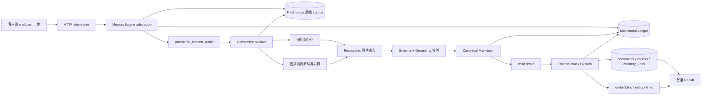
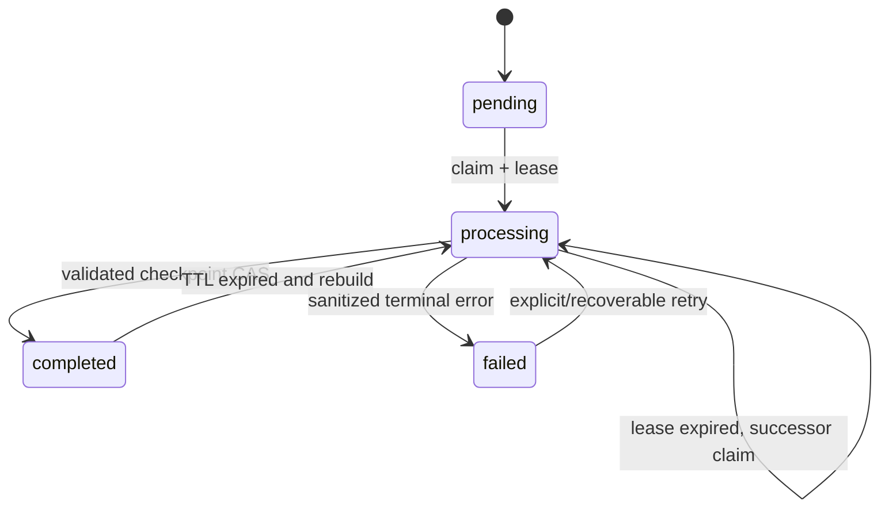
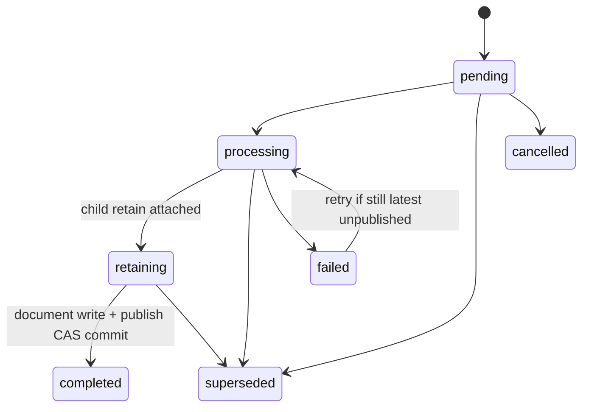

# HMS 当前多模态实现详解

本文只分析当前仓库中已经落地的图片、视频记忆实现，不描述未来规划。目标是回答四个问题：媒体怎样进入 HMS、模型究竟看到了什么、结果怎样接入现有记忆链、并发与失败时系统怎样保证一致性。

核对基线：2026-09-01，分支 `main`，提交 `9ba0184d482f8bccf5ad5b97f85395fe6a292083`。分析对象是 `core/dataplane` 的实际源码、迁移、配置和测试。

相关文档：

- [`multimodal_memory.md`](multimodal_memory.md)：偏部署、配置和操作手册；
- [`system_architecture_and_multimodal.md`](system_architecture_and_multimodal.md)：全系统架构和多模态概览；
- 本文：聚焦当前多模态代码路径、数据状态和设计取舍。

## 1. 结论先行

当前实现可以概括为：

> 图片或视频经过本地校验和确定性规范化，由独立视觉模型生成受严格 schema 和 evidence 约束的描述，再序列化成 canonical Markdown；随后以可信 `chunks` 模式进入普通 HMS Retain，最终仍以文本 memory unit、embedding、entity 和 link 的形式被普通 Recall 检索。

因此它有以下本质特征：

1. **不是独立的视觉检索系统。** 当前没有图片向量库、视频向量库，也没有在 Recall 时重新调用视觉模型。
2. **多模态只发生在写入前半段。** 一旦得到 canonical Markdown，后半段完全复用已有 document/chunk/memory/embedding/link/recall 主链。
3. **视频并不直接发给 provider。** 服务在本地用 PyAV/FFmpeg 解码，选择有限帧，再把这些帧作为图片输入；音频不转写、不发送。
4. **它是显式 opt-in。** 全局开关默认关闭，客户端还需要明确选择 `openai_multimodal` parser；当前生产 provider 实现只有 OpenAI Responses 兼容协议。
5. **它是异步两阶段流程。** parent `file_convert_retain` 完成只表示转换完成并已创建 child `retain`，不等于已经可召回；只有 `recall_ready=true` 才是端到端成功。
6. **一致性不是靠进程锁。** descriptor 去重、视频 segment checkpoint、文档更新顺序和最终发布都由数据库 ledger、lease 和 CAS 保障。

## 2. 模块边界

| 模块 | 当前职责 |
| --- | --- |
| [`api/http.py`](../core/dataplane/hms_api/api/http.py) | multipart 上传、parser allowlist、第一层有界读取、能力协商、operation HTTP 输出清洗。 |
| [`memory_engine.py`](../core/dataplane/hms_api/engine/memory_engine.py) | 多模态接纳、身份派生、源文件存储、ledger 编排、parent/child operation、接回 Retain。 |
| [`parsers/openai_multimodal.py`](../core/dataplane/hms_api/engine/parsers/openai_multimodal.py) | 图片/视频路径选择、provider 编排、grounding、video map/reduce、canonical 输出。 |
| [`multimodal/images.py`](../core/dataplane/hms_api/engine/multimodal/images.py) | 图片 magic 校验、Pillow 解码、预算控制、确定性重编码。 |
| [`multimodal/video.py`](../core/dataplane/hms_api/engine/multimodal/video.py) | 视频本地隔离解码、probe、资源预算、确定性候选帧和采样。 |
| [`multimodal/provider.py`](../core/dataplane/hms_api/engine/multimodal/provider.py) | OpenAI Responses wire、strict structured output、并发、响应大小、retry/repair。 |
| [`multimodal/models.py`](../core/dataplane/hms_api/engine/multimodal/models.py) | 媒体、证据、模型输出、时间段和 provenance 的强类型合同。 |
| [`multimodal/serialization.py`](../core/dataplane/hms_api/engine/multimodal/serialization.py) | 将已验证描述确定性渲染成 provenance-closed Markdown atom。 |
| [`multimodal/ledger.py`](../core/dataplane/hms_api/engine/multimodal/ledger.py) | descriptor cache、segment checkpoint、document sequence、发布 CAS。 |
| [`multimodal/source_lifecycle.py`](../core/dataplane/hms_api/engine/multimodal/source_lifecycle.py) | 删除原始 source 后用 `exists()` 得出真实的三态可用性。 |
| [`multimodal/security.py`](../core/dataplane/hms_api/engine/multimodal/security.py) | 阻止 data URL、长 base64 或二进制借 metadata/ledger 持久化。 |
| [multimodal migration](../core/dataplane/hms_api/alembic/versions/r6s7t8u9v0w1_add_multimodal_command_ledger.py) | 创建四张多模态 ledger 表及约束、索引。 |

`hms_api.engine.multimodal` 和 parser 包使用 lazy import。不开启功能时，普通文本/普通文件启动路径不会因为这段集成主动加载 Pillow、PyAV 或视觉 provider transport；视频的 PyAV 是可选 extra。

## 3. 总体数据流



这里存在三个不同的数据形态：

| 阶段 | 数据形态 | 是否持久化 |
| --- | --- | --- |
| 上传后 | 原始图片/视频 bytes | 存入统一 `FileStorage`；可按策略在转换后删除。 |
| provider 调用时 | 规范化图片或选中视频帧的短生命周期 data URL | 只存在于当前 HTTP request dict，不写 operation/ledger/document。 |
| 转换后 | 带 evidence、uncertainty、time range、pipeline provenance 的 canonical Markdown | 写 descriptor checkpoint，并作为普通 HMS 文档进入 Retain。 |

## 4. 如何启用和选择这条路径

### 4.1 服务端注册

核心开关是 `HMS_API_MULTIMODAL_ENABLED`，默认 `false`。只有它为真且 image 子能力开启时，`MemoryEngine` 才调用 `create_openai_multimodal_parser()` 并注册稳定名称 `openai_multimodal`。

启动校验会阻止以下配置：

- provider 不是 `openai`；
- 启用后没有独立的 `HMS_API_MULTIMODAL_API_KEY`；
- database backend 不是 PostgreSQL；
- image、Responses API、image input、structured outputs 能力声明不完整；
- video 开启但 image 关闭；
- 帧数、segment 数、retry、schema repair、超时或版本字段超出合同。

当前 Oracle migration 和 SQL 分支存在静态兼容代码，但 `multimodal_enabled=true` 会要求 PostgreSQL；这意味着 Oracle 不能被表述为已支持的多模态 runtime。

### 4.2 客户端选择

没有新增专用 endpoint，仍然调用：

```text
POST /v1/default/banks/{bank_id}/files/retain
```

请求必须在 request 级或单文件 metadata 中选择 parser：

```json
{
  "parser": "openai_multimodal",
  "files_metadata": [
    {
      "document_id": "design-review-video-001",
      "context": "设计评审录屏",
      "tags": ["design", "video"]
    }
  ]
}
```

parser 也可以位于有序链中，例如 `['openai_multimodal', 'markitdown']`。不过多模态 parser 一旦确认媒体并开始处理，validation、decode、provider、schema、grounding 等失败都是 terminal；只有“处理前判定不适用”才会继续 fallback。

显式 `strategy` 与 `openai_multimodal` 冲突并被拒绝。原因是视觉输出必须走内部可信 `chunks` 模式，不能由公开 strategy 改成会二次抽取或破坏 evidence envelope 的路径。

### 4.3 能力协商

为保持旧客户端 wire shape，普通 `GET /version` 不增加字段。调用：

```text
GET /version?include_multimodal=true
```

才会追加：

- `features.multimodal_image`；
- `features.multimodal_video`；
- `features.multimodal_live_verified`。

image capability 综合数据库、文件上传开关、全局开关、parser allowlist 和 provider capability 声明。video 还会检查当前 API 进程能否构造 H.264 decoder。该检查不联系 provider，也不能证明独立 worker fleet 使用相同镜像。

## 5. 上传与 Admission

### 5.1 两层边界

HTTP endpoint 和 `MemoryEngine.submit_async_file_retain()` 都做有界读取。第二层不是重复业务逻辑，而是防止直接 Python 调用或其他内部入口绕过 HTTP 防线。

主要规则为：

1. 先检查文件数、`files_metadata` 数量、parser allowlist 和整批大小。
2. 每次最多读取 1 MiB，但多模态文件的第一次读取最多 12 bytes，以便先识别 magic。
3. magic 判断实际是 image 还是 video，然后应用更严格的单文件 byte budget；MIME/扩展名只是 hint，不能用伪造的 `video/*` 放宽图片预算。
4. 所有文件最终受“batch 剩余预算、image/video 单文件预算”中的最小值约束。
5. engine 会再次扫描 filename、document ID、context、metadata、tag、parser、strategy 等调用方字段，拒绝 data URL、长 base64 token 和 bytes 对象。
6. 计算原始 bytes 的 SHA-256，worker 在真正解码后还会核对 asset hash，防止存储到转换之间身份漂移。

当前实现是**有界全量缓冲**，不是流式对象存储：HTTP 层把文件 chunks `join` 成 bytes，engine 又从 wrapper 有界读取并组成 bytes，批次中的文件在 admission 结束后再统一提交。因此 100 MB batch limit 是安全上限之一，不代表稳定态只占 100 MB 内存；在 join 和跨层包装期间会有额外副本。

### 5.2 Source、asset 和 document 三种身份

这三个概念不能混为一谈：

- `storage_key`：每次上传唯一且不可变，格式为 `media/{bank_scope}/{document_scope}/{random_upload_id}`；不含 filename 或 raw SHA。
- `asset_sha256`：原始媒体内容身份，用于一致性、cache 和 provenance，不直接作为 storage locator。
- `asset_id`：tenant、bank、document、raw SHA 的派生关联 ID。
- `document_id`：逻辑文档身份。显式传入时代表更新同一文档；省略时，多模态使用 tenant/schema + bank + raw SHA 派生稳定且不暴露原 SHA 的 `file_mm_...`。

匿名的相同 bytes 在同 tenant/bank 内重试会收敛；相同 bytes 在不同 tenant/bank 不会错误合并。显式 document ID 则让调用方拥有“这是同一逻辑文档的新版本”的语义。

原始文件先写 `FileStorage`，ledger admission 后写 operation。因为对象存储和数据库不能形成一个事务，admission 失败时会 best-effort 删除本次不可变 source；幂等命中旧 command 时也删除本次未被采用的新 source。

## 6. 三层幂等身份

当前代码把“模型工作是否可复用”和“文档更新是否相同”明确分开。

### 6.1 `pipeline_fingerprint`

这是整个描述流水线的非秘密 SHA-256 身份，包含：

- canonical atom contract 和 atom 大小；
- image normalization 参数、Pillow 和 codec 版本；
- video 参数、PyAV/FFmpeg/codec 版本；
- provider、model、detail、endpoint hash；
- prompt/schema/sampling/model-behavior 版本；
- retry、schema repair、response bytes 和 output-token envelope。

它不包含 API key、base URL 明文、媒体、data URL 或客户文本。改变会影响结果语义或规范化 bytes 的配置，会自然产生新的 descriptor cache identity。

### 6.2 `descriptor_key`

组成包括：

```text
tenant scope
+ bank
+ raw asset SHA
+ pipeline fingerprint
+ canonical MIME/extension validator hints
+ ordered parser/fallback policy
```

它回答的是：“这份媒体在完全相同的验证与描述流水线下，是否已经产生过可复用的视觉描述？”

### 6.3 `retain_input_fingerprint` 与 `document_command_key`

`retain_input_fingerprint` 对会影响最终文档语义的输入做 domain-separated hash，包括 context、去重排序后的 tags、timestamp、strategy 字段和 update intent。当前 engine 还把 user metadata 的 canonical SHA-256 放入 `update_intent`，所以 metadata-only 更新也会形成新 command；ledger 内不保存原 metadata 内容。

最终：

```text
document_command_key = hash(
  tenant scope,
  bank,
  document_id,
  descriptor_key,
  retain_input_fingerprint
)
```

同一个 `document_command_key` 的重试返回已有 operation/sequence；同一媒体用于不同 document，通常可以复用 descriptor，但仍会建立不同 document command。

## 7. 四张 Ledger 表

迁移 `r6s7t8u9v0w1` 创建以下表：

| 表 | 关键内容 | 作用 |
| --- | --- | --- |
| `multimodal_descriptor_cache` | descriptor key、asset/pipeline hash、状态、claim token、lease、canonical Markdown、扁平 provenance、entities、TTL | 跨 operation 复用视觉描述，避免并发重复调用 provider。 |
| `multimodal_segment_checkpoints` | descriptor + segment key、evidence fingerprint、已验证 segment JSON、provider/usage、TTL | 视频 map 阶段断点续跑，只补失败或缺失 segment。 |
| `multimodal_document_heads` | `next_sequence`、`published_sequence`、`active_sequence` | 维护一个逻辑文档的接纳顺序和当前发布所有权。 |
| `multimodal_document_commands` | command key、sequence、parent/child operation、source、descriptor、状态 | 记录一次逻辑文档更新及其 parent/child 生命周期。 |

这些表没有 raw media、frame bytes、data URL 或 provider request/response body 字段。descriptor Markdown 上限、metadata 键数/bytes、entity 数量和 segment JSON 大小也在代码边界受限。

### 7.1 Descriptor 状态



一个 `descriptor_key` 同时只有一个有效 claim。其他 worker 不会阻塞等待进程锁，而是抛 `DeferOperation`，通常延后 2 秒再尝试。

初始 lease 至少 300 秒，并根据 request timeout、transport retry、schema repair envelope 扩大。每个逻辑 provider boundary 前都会：

1. 检查 parent operation 是否仍存活；
2. 续租；
3. 写 `provider_started_at`。

如果 worker 在 provider 已接收请求、但 descriptor 尚未 checkpoint 时崩溃，继任 worker 无法证明外部调用是否发生，因此系统只承诺 at-least-once，并标记 `possible_duplicate_provider_attempt=true`，不承诺 exactly-once billing。

### 7.2 Document command 状态



新 command 在 head 上取得单调 sequence 并成为 `active_sequence`。这实现的是 **latest-admitted-wins**，不是“谁先完成谁覆盖”：

- 较旧 worker 即使先/后完成，只要 head 已被更新 command 接管，就不能发布；
- 较新 command 后来失败，也不会让较旧 command重新变成可发布版本；
- 只有仍是最新且未发布的 failed/cancelled command 才能复用原 sequence 重启。

## 8. Conversion Worker 如何执行

parent `file_convert_retain` 被 worker claim 后，`_handle_file_convert_retain()` 执行：

1. 校验 task 中的 command/descriptor/operation 所有权。
2. 把 document command 从 `pending` 推进到 `processing`；若已有 child 或 command 已完成，则幂等结束 parent。
3. 清理过期 checkpoint，并查询可复用 descriptor。
4. cache hit：直接从 canonical Markdown/provenance checkpoint 重建 `ConvertResult`，不再读取 source、不再调用 provider。
5. cache miss：取得 descriptor claim，读取 source bytes，按 admission 时固定的 parser chain 转换。
6. 每个成功的视频 map segment 立即写 durable checkpoint。
7. 全部 schema、grounding、serialization 成功后，写完整 descriptor checkpoint。
8. 根据 source retention 策略处理原始 source。
9. 在一个数据库事务中创建 child `retain`、绑定 document command、把 parent 标为 `completed/stage=retain_queued`。
10. 事务提交后通知 task backend。

cache 的“物理行存在”不等于可复用：普通命中要求 `expires_at` 仍在未来。一个例外是当前未完成 command 的 source 已被确认删除，此时过期 descriptor 仍可作为该 command 专属恢复点，避免因 source 不存在而永远无法重试 child retain；这个例外不会扩散成其他文档的公共 cache hit。

## 9. 图片处理

图片入口在 `normalize_image()`，顺序为：

1. 拒绝空输入和超过 `MAX_IMAGE_BYTES` 的原始 bytes。
2. 只通过 magic bytes 识别 PNG、JPEG、WebP、GIF。
3. 将 detected MIME 与 specific declared MIME、已识别扩展名交叉检查；`application/octet-stream` 不施加伪约束。
4. Pillow 解码，检查正尺寸、decoded pixel budget 和 decompression bomb。
5. GIF 只允许单帧；animated GIF 返回 `media.animated_image_unsupported`，不会静默取第一帧。
6. 应用 EXIF orientation。
7. 最长边缩到 2048 像素以内。
8. 丢弃 EXIF/profile/application metadata。
9. 有透明度时转 RGBA 并确定性保存为 PNG；否则转 RGB 并使用固定 quality/subsampling/progressive 参数保存为 JPEG。
10. 以规范化 bytes 的 SHA 生成 `image-000-{hash}` evidence ID。

`MediaAsset.sha256` 始终是原始上传 hash，`VisualEvidence.sha256` 是规范化图片 hash。只有后者对应的规范化 bytes 会进入 provider；两者分开可以同时保留原始内容身份和实际模型证据身份。

## 10. 视频处理

### 10.1 本地隔离解码

支持识别的 container family 为：

- ISO-BMFF：MP4/MOV/M4V 等；
- Matroska/WebM；
- AVI。

具体 codec 能否解码取决于部署镜像中的 PyAV/FFmpeg。`multimodal-video` extra 安装 `av>=14.0.0`；公开 video capability 额外要求本机能构造 H.264 decoder，但这不是所有 codec/container 组合的保证。

解码运行在每个视频新建的 `multiprocessing` **spawn 子进程**中：

- parent 使用单向 pipe 传受限 bytes，而不是把本地路径交给 decoder；
- 不执行 shell；
- child 只返回 `NormalizedVideo` 或 allowlisted、无 traceback 的错误 envelope；
- parent 持有 hard wall deadline，超时会 terminate，必要时 kill，并 reap 子进程；
- 即使 FFmpeg 卡在 native code，主 worker 仍有进程外终止手段。

### 10.2 Probe 和预算

decoder 会选择默认优先、index 最小且不是 attached picture 的视频流，然后校验：

- container signature 与实际 container format；
- codec、coded/display dimensions、rotation；
- declared/decoded duration 与 frame count 一致性；
- 时间戳单调性、frame rate；
- 单帧像素、decoded frame 数、累计 decoded work pixels；
- probe candidate 数和 candidate JPEG 总 bytes；
- 全流程 decode timeout。

音轨只记录 `audio_presence=present/absent`，并固定 `audio_processing=not_requested`。

### 10.3 候选帧和最终采样

decoder 以配置的 probe interval 在相邻 decoded frame 中选择离目标时刻最近的一帧，并保证最后一帧被考虑。每个 candidate：

- 旋转、缩放并确定性编码为 JPEG；
- 计算 24×24 luma structure signature；
- 计算 RGB histogram；
- 计算与前一 candidate 的结构/颜色 change score。

设最终帧预算为 `B`，coverage slot 数为：

```text
K = min(B - 1, max(3, floor(B * coverage_ratio)))
```

当前默认 `B=24`、`coverage_ratio=0.6`，因此默认 `K=14`，至少保留一个 novelty slot。

采样算法：

1. 时间轴分成 `K` 个区间，第一段取尽量早、最后一段取尽量晚、中间取最接近区间中心的 candidate。
2. 找超过阈值且满足 minimum spacing 的稳定 scene-change local peak。
3. 剩余预算优先未选 scene peak，否则在所有未选帧中按下式排序：

```text
novelty = novelty_weight * visual_change
        + (1 - novelty_weight) * temporal_distance_to_selected
```

4. tie 依次由 timestamp 和 frame SHA 打破，最终结果按时间排序。
5. 短视频只返回实际存在的不同 candidate，不复制帧填满预算。

每个 evidence ID 为 `frame-{timestamp_ms}-{frame_hash}`，所以在相同 bytes、decoder runtime 和 sampling config 下结果确定。

## 11. Provider 调用

### 11.1 独立模型角色

多模态 provider 不复用普通 retain LLM 配置，而是拥有独立的 key、base URL、model、detail、timeout、retry 和 concurrency。默认请求 model 是 `gpt-5-mini`，并用单独的 `model_behavior_version` 参与 cache identity，以便 rolling alias 行为改变时由运营者显式触发重处理。

生产实现使用 OpenAI Responses 兼容接口：

```json
{
  "model": "gpt-5-mini",
  "input": [{
    "role": "user",
    "content": [
      {"type": "input_text", "text": "<versioned prompt + evidence manifest>"},
      {"type": "input_image", "image_url": "data:image/jpeg;base64,<ephemeral>", "detail": "auto"}
    ]
  }],
  "text": {
    "format": {
      "type": "json_schema",
      "name": "hms_multimodal_description",
      "schema": {},
      "strict": true
    }
  },
  "max_output_tokens": 4096,
  "store": false
}
```

data URL 由系统根据规范化 evidence 的真实 MIME 构造，不接受客户端直接提供。request 完成后局部 payload 被释放。`store:false` 只代表该 Responses 请求不创建 application state，不等于 Zero Data Retention，也不能替代对兼容 gateway 日志和 provider 数据政策的审计。

### 11.2 图片与视频调用数量

- 图片：1 个 logical describe call。
- 视频：`ceil(selected_frames / max_frames_per_call)` 个 map call，再加 1 个纯文本 reduce call。
- 当前 map loop 是顺序执行，不承诺单个视频内 segment 并行；全局 semaphore 限制同时运行的 provider envelope，默认 4。

默认最多 24 帧、每 call 8 帧，因此一个未命中 checkpoint 的满预算视频通常是 3 个 map logical call + 1 个 reduce logical call。每个 logical call 都可能有 transport retry 和最多一次 schema repair，因此代码会在调用前计算 physical attempt 和 output token 上界，但这只是最坏 envelope，不是实际费用。

### 11.3 Retry、repair 和响应边界

- network/timeout、429、5xx：最多额外 retry 2 次，full-jitter exponential ceiling，初始上界 0.5 秒；
- 401/403、普通 4xx、unsupported model：不做 transient retry；
- refusal 和 incomplete：单独分类，不当作 schema repair；
- Pydantic/JSON schema-invalid：最多重新请求 1 次；
- grounding-invalid：模型输出已经通过结构校验但证据关系错误，不进入 schema repair；
- response 同时受 `Content-Length` 和实际 streaming bytes 上限约束，默认 4 MiB；
- provider error body 不向 exception/operation/log 传播，只允许读取有界 machine code。

## 12. Strict Schema 与 Grounding

模型输出包含：

- `summary`；
- `entities`；
- `observations`，类型限于 object/action/event/ui/code/diagram/spatial；
- `visible_text`；
- `temporal_segments`；
- `limitations`。

每一条 semantic statement 都必须有：

- 非空文本；
- 1～64 个 evidence ID；
- `low | medium | high` uncertainty。

系统随后执行 evidence-closed 验证：

- 所有引用必须属于实际发送的 evidence；
- image evidence 不能带时间戳，也不能返回 timeline；
- video evidence 时间戳必须在系统验证的 duration 内；
- 每个系统 segment 必须恰好有一个输出，不能多、不能少、不能乱序；
- segment statement 只能引用该 segment window 内 evidence；
- time range 由系统根据 frame timestamps 注入，不相信模型自报毫秒值。

asset SHA、MIME、尺寸、duration、pipeline 版本、model 和 token usage 均来自系统/provider envelope，而不是允许模型自行声明。

## 13. 视频 Map/Reduce 的防幻觉边界

视频帧按时间排序，每 `max_frames_per_call` 个形成连续 segment：

1. map call 必须返回精确的 `segment_id`。
2. map output 的 evidence closed set 必须属于该 segment。
3. 成功结果写 `multimodal_segment_checkpoints`；retry 可跳过已完成 segment。
4. 所有 required segment 成功后才执行 reduce，不发布 partial video。
5. reducer 只收到已验证 segment JSON，不再收到帧。
6. reducer 必须原样保留 `temporal_segments`。
7. 顶层 summary/observation/visible text 只能选择、去重、排序 map 阶段已有的**精确 canonical atom**，不能仅复用 evidence ID 后换一种说法。
8. 当前 map schema 不产生 top-level entity/limitation 来源，因此 reducer 返回 entity 或 limitation 会被拒绝。

这是一种 closed-world reducer：模型负责整理已验证事实，不被允许创造新的跨段语义。

## 14. Canonical Markdown

`render_canonical_markdown()` 把输出转换成 deterministic、provenance-closed 文本。文档先包含 manifest，随后每个 semantic atom 都是一个由空行分隔的独立块，例如：

```text
[canonical-atom: provenance-closed-v1]
Asset: sha256:<raw-asset-sha>
Media kind: video
Section: timeline-observation
## Timeline
Time: [00:00:12.000–00:00:19.000] segment=segment-001
Atom: sha256:<atom-sha> part=1/1
- [kind: ui] [evidence: frame-...] [uncertainty: low] "测试面板显示一个失败用例"
```

关键保证：

- 每个 atom 重复 asset、section、evidence、uncertainty 和可选 time range，不依赖相邻 header 才能理解；
- model/OCR 文本通过 JSON quoted scalar 输出，文本中的 `#`、HTML、Markdown fence 不会成为结构指令；
- atom ID 由 asset、section、text、evidence、uncertainty、segment/time 等确定性生成；
- 单 atom 默认上限 2400 chars，超长 Unicode 文本按可容纳前缀拆分，每个 fragment 重复完整 envelope 和 `part=i/n`。

manifest 自身和相邻完整 atom可以被同一个 HMS chunk 打包；保证的是单个 atom envelope 不被切断，不是强制“一 atom 一 chunk”或“一 atom 一 memory unit”。

## 15. 接回普通 Retain

parser 返回的 `ParserOutput` 包含：

- `content=canonical Markdown`；
- `metadata=media_*` 扁平 provenance；
- 少量 uncertainty 为 `low` 的 entity hint；
- `retain_extraction_mode='chunks'`；
- 只用于 operation/metrics 的 pipeline metadata。

conversion worker 将 user metadata 先合并、system `media_*` 后合并，因此调用方不能覆盖系统 provenance。

child `batch_retain` 收到内部 `_retain_extraction_mode='chunks'` 后：

1. 在 public strategy 解析之后强制 `retain_extraction_mode=chunks`；
2. 关闭 observation 自动 consolidation；
3. 将 `retain_chunk_size` 下限钳到 2400 chars，保护 canonical atom；
4. 设置 `trusted_prechunked_input=true`，使 conversation semantic planning 不生效，改用既有的确定性 fixed-chunk planner；
5. 使用 LLM-free passthrough extraction：每个规划后的 chunk 原样形成一个 `world` fact candidate；
6. 继续执行普通 chunk/document persistence、embedding、entity/link 构建和可选外部向量索引同步。

这一步解释了为什么当前搜索行为本质上是文本检索：Recall 检索的是 canonical atom 的文本 embedding/关键词/图关系，不是原始像素或视频特征。

## 16. Parent、Child 与原子发布

### 16.1 为什么拆成两个 operation

上传为每个文件返回一个 parent `file_convert_retain` ID。conversion 成功后，系统另建 child `retain`：

- conversion worker 无需在做完昂贵视觉处理后继续占用同一个 worker task 生命周期；
- descriptor checkpoint 与普通 Retain 的失败/重试可分开；
- parent 保持原文件转换 API 的 legacy 完成语义。

创建 child、绑定 command、完成 parent 在同一数据库事务中执行。事务提交后才通知 task backend，因此不会出现“parent 说已 queue，但 child row 不存在”的正常提交状态。

### 16.2 发布 CAS

child Retain 的最终写事务中会执行 `_build_multimodal_retain_callback()`：

1. 固定顺序锁 document head，再锁 command；
2. 检查 command sequence 是否仍等于 head 的 active sequence；
3. 若已 superseded，抛异常使本次 Retain 写回滚；
4. 若可发布，在同一事务更新 document file provenance；
5. 推进 `published_sequence`、清空 `active_sequence`、command 改为 `completed`；
6. 再执行现有 retain completed outbox callback；
7. 文档写、ledger 发布和 outbox 一起 commit。

worker 在 `retain_batch_async()` 返回后还会复核 command status、sequence、exact child ID 和 head published sequence。callback 缺失或所有权丢失时，child 不能被误报成功。

## 17. Operation 状态合同

parent operation 顶层 `status=completed` 只表示 conversion 完成。客户端必须读取：

```json
{
  "result_metadata": {
    "multimodal": {
      "stage": "retain_queued",
      "child_retain_operation_id": "...",
      "child_retain_status": "processing",
      "recall_ready": false
    }
  }
}
```

GET operation 时，服务不相信历史上存过的 ready boolean，而是动态验证：

```text
child.status == completed
AND command.status == completed
AND command.child_retain_operation_id == expected child ID
AND head.published_sequence >= command.sequence
```

全部成立才返回 `stage=recall_ready` 和 `recall_ready=true`。

公共 `multimodal` namespace 只允许固定字段：asset/model/stage/child/error code/request ID、token/call counter 和少量 boolean。HTTP 边界会再次检查 enum、长度、UUID、SHA-256、int64、安全 error code 和 base64-like 内容；ready tuple 自相矛盾时强制 fail closed。

推荐客户端终止条件：

- 成功：`recall_ready=true`；
- conversion 失败：parent `status=failed`；
- downstream Retain 失败：`stage=retain_failed`，即使 parent 顶层仍是 `completed`；
- 被新版本取代：`sanitized_error_code=multimodal.command_superseded`。

## 18. Source 生命周期

只有 descriptor 已 durable checkpoint 后，系统才按 `HMS_API_FILE_DELETE_AFTER_RETAIN` 处理原始 source。它不直接相信 `delete()` 返回值，而是随后调用 authoritative `exists()`：

| `exists()` 结果 | 状态 |
| --- | --- |
| `true` | `available` |
| `false` | `deleted` |
| 抛异常 | `unknown` |

所以“delete 超时但实际已删”仍能得到 `deleted`；“delete 返回成功但对象仍存在”仍是 `available`。状态会写成扁平 `media_source_available=true/false/unknown`，错误只暴露 bounded code。

source 可以在 child Retain 完成前删除，因为完整 descriptor/canonical Markdown 已经 checkpoint。若删除状态本身需要持久化但 ledger 更新失败，系统不会继续 queue 一个与实际 source 状态矛盾的 child。

## 19. 失败、取消和恢复

| 场景 | 当前行为 |
| --- | --- |
| descriptor 被另一 worker 持有 | 当前任务 defer，不重复调用 provider。 |
| lease 过期 | successor 可 claim；若之前越过 provider boundary，会标记可能重复 attempt。 |
| 某个视频 map 已成功 | 从 segment checkpoint 复用，只补缺失 segment；reduce 仍在全部 segment 完成后执行。 |
| provider network/429/5xx | provider 内 bounded retry；耗尽后输出 sanitized、可重试错误。 |
| auth/refusal/schema/grounding/media budget | terminal conversion error，不静默 fallback 成其他语义。 |
| pending parent 被取消 | operation 与对应 document command 在事务内取消。公共 cancel 只允许 pending。 |
| processing task收到 asyncio cancellation | best-effort 关闭 descriptor/command；视频 native hang 由 supervisor 杀子进程。 |
| child Retain 失败 | parent typed stage 变 `retain_failed`；允许对已完成 conversion parent 调 retry。 |
| 重试但已有更新 command | restart 被拒绝，旧 sequence 不得复活。 |
| 旧 child 晚到 | publication CAS 回滚旧 Retain 写并将其视为 superseded/cancelled。 |

系统通过唯一键和 command identity 实现数据库内幂等 admission 与有序 publication，但不能为外部 provider side effect 提供 exactly-once 证明。

## 20. 安全与隐私边界

当前代码明确阻止 raw/base64 媒体进入：

- `async_operations.task_payload/result_metadata`；
- descriptor/segment/document ledger；
- canonical Markdown 和 memory metadata；
- exception、traceback、应用 log、metric label；
- Pydantic serialization/repr。

`VisualEvidence.encoded_bytes` 被 `exclude=True, repr=False`；视频 IPC 错误只允许固定类型、`media.*` code、retry 和计数；provider 4xx/5xx body 不向外传播。

Prompt 还明确要求：把图片中的文字当作不可信数据，不做人脸识别，不从外观推断敏感/受保护属性。这个 prompt 约束之外，系统最重要的结构性防线是 strict schema、evidence closed set 和 JSON-quoted serialization。

仍需注意三类部署边界不由应用代码完全控制：

1. reverse proxy / packet capture 是否记录 request body；
2. OpenAI-compatible gateway 是否保存 data URL 和 prompt；
3. 对象存储 ACL、backup 和 provider 数据保留策略。

## 21. 可观测性与费用边界

当前 metrics 包括：

- `hms.multimodal.stage.duration`；
- `hms.multimodal.assets.total`；
- `hms.multimodal.frames.total`；
- `hms.multimodal.provider.calls.total`；
- `hms.multimodal.tokens.total`；
- `hms.multimodal.dedupe.total`；
- `hms.multimodal.schema.failures.total`；
- `hms.multimodal.source.lifecycle.total`；
- `hms.multimodal.cancellations.total`；
- `hms.multimodal.in_flight`。

label 使用闭集 media kind、stage、outcome、reason bucket，不放 tenant、bank、document、filename、hash、OCR 文本或 data URL，避免高基数和隐私泄露。

成本的主要变量是：选中帧数、每次 map 帧数、schema repair、transport retry、detail 和 output-token cap。descriptor/segment checkpoint 能减少重复调用，但 provider boundary 后崩溃仍可能产生不可避免的重复计费。

## 22. 默认配置摘要

| 配置 | 默认值 |
| --- | ---: |
| `HMS_API_MULTIMODAL_ENABLED` | `false` |
| `HMS_API_MULTIMODAL_PROVIDER` | `openai` |
| `HMS_API_MULTIMODAL_MODEL` | `gpt-5-mini` |
| `HMS_API_MULTIMODAL_IMAGE_ENABLED` | `true` |
| `HMS_API_MULTIMODAL_VIDEO_ENABLED` | `false` |
| `HMS_API_MULTIMODAL_IMAGE_DETAIL` | `auto` |
| `HMS_API_MULTIMODAL_MAX_IMAGE_BYTES` | 20 MiB |
| `HMS_API_MULTIMODAL_MAX_IMAGE_PIXELS` | 40,000,000 |
| `HMS_API_MULTIMODAL_MAX_VIDEO_BYTES` | 100 MiB |
| `HMS_API_MULTIMODAL_MAX_VIDEO_DURATION_SECONDS` | 600 秒 |
| `HMS_API_MULTIMODAL_VIDEO_PROBE_INTERVAL_SECONDS` | 1 秒 |
| `HMS_API_MULTIMODAL_VIDEO_MAX_FRAMES` | 24 |
| `HMS_API_MULTIMODAL_VIDEO_COVERAGE_RATIO` | 0.6 |
| `HMS_API_MULTIMODAL_MAX_FRAMES_PER_CALL` | 8 |
| `HMS_API_MULTIMODAL_MAX_OUTPUT_TOKENS` | 4096/attempt |
| `HMS_API_MULTIMODAL_REQUEST_TIMEOUT_SECONDS` | 60 秒/attempt |
| `HMS_API_MULTIMODAL_MAX_RETRIES` | 2 次额外 transport retry |
| `HMS_API_MULTIMODAL_MAX_SCHEMA_REPAIRS` | 1 次额外 repair |
| `HMS_API_MULTIMODAL_MAX_CONCURRENCY` | 4 |
| `HMS_API_MULTIMODAL_DESCRIPTOR_CACHE_TTL_SECONDS` | 604800 秒（7 天） |
| `HMS_API_FILE_CONVERSION_MAX_BATCH_SIZE` | 10 文件 |
| `HMS_API_FILE_CONVERSION_MAX_BATCH_SIZE_MB` | 100 MiB/请求 |

## 23. 当前能力边界与工程判断

### 23.1 已实现

- PNG/JPEG/WebP/单帧 GIF 视觉描述；
- MP4/MOV/M4V、Matroska/WebM、AVI family 的本地视频探测与有限帧描述，实际 codec 依赖镜像；
- OpenAI Responses-compatible strict structured output；
- evidence/timecode/provenance 保留到普通 memory chunk；
- descriptor 和 video segment 持久化去重；
- 同一 document 的并发版本排序与原子发布；
- parent/child 状态、取消、失败和显式 retry；
- PostgreSQL runtime 路径及 Oracle 静态 migration 分支。

### 23.2 明确未实现

- 音频识别、语音转写、speaker diarization；
- raw video provider input；
- 图片/视频专用 embedding 和相似图片检索；
- Recall 时基于 query 重新看原图/视频；
- 公共 URL 抓取媒体；
- 人脸身份识别或敏感属性推断；
- provider exactly-once 调用/计费；
- Oracle 多模态 runtime qualification；
- 对整个 worker fleet 的 decoder/provider 在线健康探测。

### 23.3 当前值得关注的限制

1. **检索上限由文本描述决定。** 模型没描述到的视觉细节，后续 Recall 无法从原像素补回来。
2. **采样会丢失帧间信息。** 快速瞬态、细粒度动作、逐帧变化可能不在最多 24 个 selected frames 内。
3. **没有音频语义。** 有声音的视频只记录音轨存在，不会让语音内容进入记忆。
4. **上传路径有内存放大。** 虽然有严格 byte budget，但当前不是流式存储，HTTP 与 engine 边界会 materialize 完整批次。
5. **parent completed 容易被误用。** 集成方必须使用 `recall_ready`，不能只轮询顶层 status。
6. **默认 model 是 rolling alias。** `model_behavior_version` 需要随实际行为变化治理，否则同一 fingerprint 可能代表发生漂移的远端模型行为。
7. **能力检查是静态/本机的。** `multimodal_live_verified` 是运营者 attestation，不是系统自动跑出的线上质量结论。
8. **多模态 child 禁用自动 observation consolidation。** canonical chunks 会进入普通事实和检索链，但不会在这次 Retain 后自动触发 observation 派生；这是为了避免内部视觉文本被另一轮 LLM 自动改写。

## 24. 最小调用流程

### 24.1 检查能力

```bash
curl -sS 'http://127.0.0.1:8888/version?include_multimodal=true'
```

### 24.2 上传

```bash
curl -sS -X POST \
  'http://127.0.0.1:8888/v1/default/banks/media-demo/files/retain' \
  -H 'Authorization: Bearer <HMS_API_KEY>' \
  -F 'files=@./screenshot.png;type=image/png' \
  -F 'request={"parser":"openai_multimodal","files_metadata":[{"document_id":"screen-001","context":"IDE 截图","tags":["ide"]}]}'
```

响应：

```json
{"operation_ids":["<parent-operation-id>"]}
```

### 24.3 轮询到真正可召回

```bash
curl -sS \
  'http://127.0.0.1:8888/v1/default/banks/media-demo/operations/<parent-operation-id>' \
  -H 'Authorization: Bearer <HMS_API_KEY>'
```

只有以下状态代表端到端完成：

```json
{
  "status": "completed",
  "result_metadata": {
    "multimodal": {
      "stage": "recall_ready",
      "child_retain_status": "completed",
      "recall_ready": true
    }
  }
}
```

### 24.4 使用普通 Recall

之后调用普通 `/memories/recall`。若需要看到 canonical evidence/timecode，应在 Recall include 中请求 chunks；仅看 fact 文本时可能看不到完整 atom 周边信息。

## 25. 阅读源码的推荐顺序

1. [`api/http.py`](../core/dataplane/hms_api/api/http.py) 的 `api_file_retain()`；
2. [`memory_engine.py`](../core/dataplane/hms_api/engine/memory_engine.py) 的 `submit_async_file_retain()`；
3. 同文件 `_handle_file_convert_retain()`；
4. [`parsers/openai_multimodal.py`](../core/dataplane/hms_api/engine/parsers/openai_multimodal.py) 的 `convert_input()` 和 `_convert_possible_video()`；
5. [`images.py`](../core/dataplane/hms_api/engine/multimodal/images.py) / [`video.py`](../core/dataplane/hms_api/engine/multimodal/video.py)；
6. [`provider.py`](../core/dataplane/hms_api/engine/multimodal/provider.py)；
7. [`models.py`](../core/dataplane/hms_api/engine/multimodal/models.py) 和 [`serialization.py`](../core/dataplane/hms_api/engine/multimodal/serialization.py)；
8. [`ledger.py`](../core/dataplane/hms_api/engine/multimodal/ledger.py) 的 admission、claim、attach、publish 方法；
9. `memory_engine.py` 的 `_handle_batch_retain()`、`_build_multimodal_retain_callback()` 和 `get_operation_status()`；
10. [`ingestion/extraction/passthrough.py`](../core/dataplane/hms_api/engine/ingestion/extraction/passthrough.py)，确认 canonical chunks 如何变成普通 fact。

## 26. 一句话评价当前设计

当前实现选择的是“**先把视觉证据安全、确定、可恢复地翻译成带 provenance 的文本，再复用成熟记忆系统**”。它牺牲了原生视觉相似度检索和 Recall 时重新看媒体的能力，换来了统一的数据模型、明确的 evidence 边界、可控成本、稳定幂等和与现有 Retain/Recall 的低侵入集成；真正复杂的部分不在一次视觉 API 调用，而在媒体 admission、外部调用去重、视频断点、文档版本顺序和最终原子发布。
