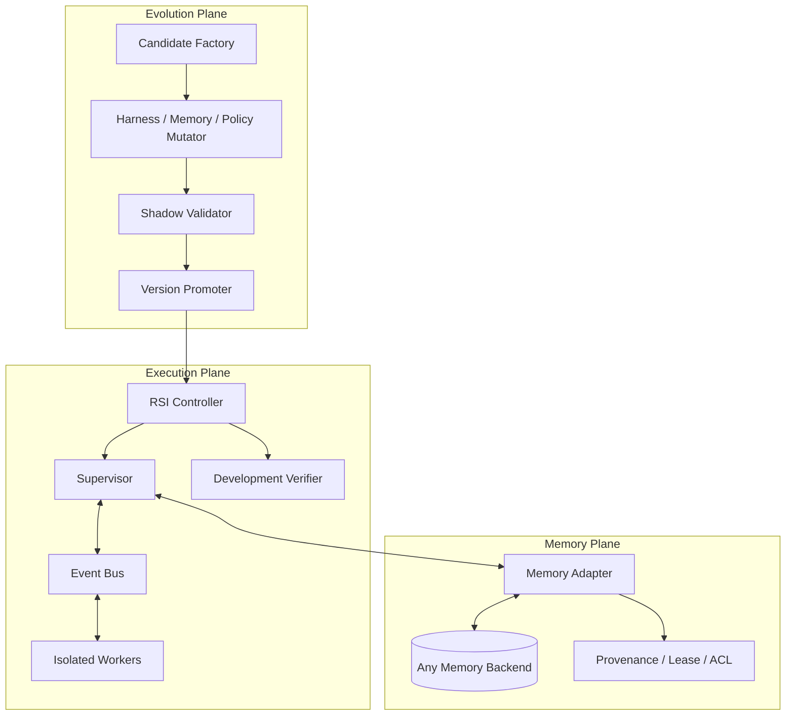

# Memory-Agnostic RSI Harness 设计

本文定义一个可以接入 HMS、向量数据库、图记忆、文件记忆或自研记忆系统的运行时自进化框架。它把记忆系统当作可替换的存储后端，把 Supervisor、Worker、Verifier 和演化策略放在独立的 Harness 层。

这里的 RSI（recursive self-improvement）指 Harness 能够在不修改基础模型参数的前提下，递归改进以下资产：

- 可复用技能和失败模式；
- 记忆抽取、检索、压缩和晋升策略；
- Supervisor 的诊断和 steering 策略；
- Worker 的任务分解、工具路由和 checkpoint 策略；
- 这些组件的组合配置。

Benchmark 不参与候选知识的生成，也不向进化环路暴露任务集、隐藏测试、参考答案或逐步评分信号。Benchmark 只在冻结的 Harness 版本上做最终评估。

## 1. 目标和边界

目标是让同一个 Harness 在一组新的、未见过的任务实例上逐步提升成功率、可靠性和 token 效率，同时保留完整来源、版本和审计信息。

不把以下内容视为自进化：

- 把上一次任务的完整 transcript 直接放进下一次 prompt；
- 保存 benchmark 的 patch、hidden test、参考输出或 verifier 解释；
- 通过反复读取 benchmark pass/fail 来搜索一个只适合该 benchmark 的答案；
- 把一次偶然成功的轨迹自动写成永久事实；
- 修改模型参数但没有对 Harness 行为进行可审计的版本化。

“完全没有 benchmark 泄漏”不能靠一条 prompt 指令保证，必须由数据路径、权限、时间顺序和评测流程共同强制。本文采用 benchmark embargo：benchmark 只存在于独立的评测环境，进化环境和评测环境没有共享可写存储、没有共享 verifier、没有共享任务标识，也没有共享明文结果。

## 2. 总体架构



三个平面必须隔离：

1. **Execution Plane** 运行任务，不负责决定长期记忆是否可信。
2. **Memory Plane** 提供受限的检索、暂存、晋升、废弃和快照接口，不暴露后端细节。
3. **Evolution Plane** 生成和验证记忆、策略及 Harness 变更，只能读取被允许的开发任务证据。

HMS 适合作为 Memory Plane 的一个实现；现有 `MemoryEngine`、Recall、Retain、Reflect、Mental Model、Directive 和异步 Worker 可以复用，但不应把 RSI Controller 放入 `MemoryEngine` 内部。

## 3. 与记忆系统无关的统一接口

所有后端只需要实现下面的接口。接口返回的内容必须带来源和版本，不允许只返回一段没有 provenance 的字符串。

```python
class MemoryBackend(Protocol):
    def snapshot(self, namespace: str) -> str: ...

    def search(
        self,
        namespace: str,
        query: str,
        *,
        token_budget: int,
        filters: dict[str, object] | None = None,
    ) -> list[MemoryHit]: ...

    def fetch(self, memory_id: str, *, detail: str = "summary") -> MemoryItem: ...

    def stage(self, candidate: MemoryCandidate) -> str: ...

    def promote(self, candidate_ids: list[str], *, target_snapshot: str) -> str: ...

    def quarantine(self, candidate_ids: list[str], reason: str) -> None: ...

    def invalidate(self, memory_ids: list[str], reason: str) -> None: ...

    def restore(self, snapshot_id: str) -> None: ...
```

推荐的数据结构如下：

```python
class MemoryCandidate:
    kind: Literal["procedure", "failure", "fact", "constraint", "routing"]
    scope: Literal["general", "project", "episode"]
    trigger: str
    content: str
    preconditions: list[str]
    anti_patterns: list[str]
    evidence_refs: list[str]
    source_run_id: str
    source_commit: str | None
    created_before_verifier: bool
    redaction_report: dict[str, object]
```

后端的映射方式可以不同：

- HMS：`search` 对应 Recall，`stage` 对应带 candidate tag 的 Retain，项目摘要可以使用 Mental Model；
- 向量库：用 metadata 保存 scope、版本和 evidence refs；
- 文件系统：用目录和 manifest 实现 snapshot、stage、promote；
- 图记忆：用节点类型和边表示 precondition、evidence 和 contradiction。

Harness 不应依赖任何一个后端的表名、embedding 算法或查询语言。

## 4. 运行时协议

Worker 只发送结构化事件，不把完整工具输出持续复制给 Supervisor：

```json
{
  "run_id": "run-123",
  "worker_id": "worker-1",
  "seq": 42,
  "type": "progress|question|risk|error|result|inactivity",
  "goal_delta": "当前目标相对上一个 checkpoint 的变化",
  "observation": "经过脱敏的观察",
  "attempt": "已经尝试的动作",
  "outcome": "动作结果",
  "risk": "可能的偏离或阻塞",
  "next_step": "Worker 计划的下一步",
  "trace_refs": ["trace://run-123/step-42"]
}
```

Supervisor 只能发出四类动作：

```text
NOTIFY_ACK       接收事件并继续
STEER            为下一轮 Worker 推理排队指导
ABORT            中止当前 Worker
SPAWN            使用当前已提交 Harness 启动新 Worker
```

如果 Agent runtime 不支持实时注入，`STEER` 必须降级为 checkpoint 后重启 Worker，而不是伪装成实时 steering。

一次运行的最小状态是：

```text
task_spec
current_goal
current_plan
recent_event_digests
retrieved_memory_ids
open_risks
candidate_ids
worker_states
```

完整 transcript、shell 输出和文件 diff 放在 trace store；Supervisor 只有在需要诊断时通过 `trace_ref` 拉取片段。

## 5. 三层记忆和严格命名空间

```text
episode/<run_id>       当前运行的临时状态和完整轨迹
candidate/<run_id>     已提炼但尚未晋升的候选知识
project/<repo_id>      项目约束、架构决定、环境事实
general/<domain>       可迁移的程序、失败模式和工具策略
```

评测 Worker 默认只能访问 `project` 和 `general` 的冻结快照，不能访问其他评测实例的 `episode` 或 `candidate`。

对于 Coding Agent，建议使用：

```text
repo_id = hash(normalized_git_remote + repository_root_identity)
branch、commit、module、agent、user = metadata/tags
```

不要仅使用工作目录 basename 作为项目 ID，也不要把所有仓库放在一个共享 Bank 中。

## 6. 无泄漏协议

### 6.1 数据分类

所有输入在进入 Retain 或 Candidate Factory 前必须分类：

```text
SAFE_GENERAL       可迁移的通用方法和失败模式
SAFE_PROJECT       项目约束和经过允许范围验证的事实
EPISODIC_ONLY      当前任务的路径、变量、补丁和临时状态
BENCHMARK_SECRET   hidden test、参考答案、评分细节、任务 ID
SENSITIVE          密钥、个人数据、客户代码和未授权文件
```

`BENCHMARK_SECRET` 必须在进入 Agent、Memory Plane 和 Evolution Plane 之前被拒绝。`EPISODIC_ONLY` 只能进入当前 run namespace。

### 6.2 时间顺序约束

每一个候选记忆必须记录 `created_before_verifier=true`。系统拒绝以下情况：

- verifier 运行后才生成候选内容；
- 候选内容包含 verifier stdout/stderr；
- 候选内容引用 hidden test、参考 patch 或评分解释；
- Supervisor 看到 benchmark 结果后修改原候选文本；
- 用 benchmark 的错误消息构造新的 procedure。

Verifier 只能在候选封存后返回一个不可逆的结果令牌。Promoter 可以用这个令牌决定是否晋升，但不能把 verifier 的文本反馈回 Candidate Factory。

### 6.3 Benchmark embargo

真正的 benchmark 评估使用单独的进程、数据库、对象存储和凭据：

```text
Evolution Environment  --无 benchmark 访问-->  Benchmark Environment
Benchmark Environment  --无回写权限------->  Memory / Evolution Store
```

推荐的评测流程是：

1. 在开发任务和合成变体上演化 `H_i`；
2. 关闭 Evolution Plane；
3. 对 `H_i` 做只读快照；
4. 在全新的 benchmark 环境运行；
5. 只在报告中记录结果，不把结果写回当前演化快照。

如果需要研究“多轮之后在同类任务上提升”，应使用训练任务、随机化任务实例或隐藏的 held-out 任务族，而不是反复读取 benchmark 的同一实例。

## 7. RSI 的三层递归循环

### 第一层：运行中自修正

Supervisor 根据事件摘要、当前目标和有限记忆进行 `STEER`，帮助当前 Worker 脱离错误策略。

### 第二层：经验自进化

运行中提炼 procedure、failure、constraint 和 routing candidate；任务结束后由 development verifier 决定是否晋升。晋升后的知识进入新的 Harness snapshot。

### 第三层：Harness 自进化

Evolution Plane 可以提出以下变更：

- Supervisor prompt 或诊断模板；
- 事件摘要格式；
- Recall 查询改写和排序权重；
- 记忆晋升阈值；
- Worker checkpoint 频率；
- 工具路由和子 Agent 分工；
- 技能 schema 和冲突规则。

每个变更必须作为 `HarnessCandidate` 存在于隔离版本中：

```text
H_i
  -> mutate(H_i) = H'_i
  -> shadow validation on development tasks
  -> regression / safety checks
  -> promote H'_i only if it wins on held-out development tasks
```

不能让 Harness 在生产任务中直接修改自己的执行代码或权限。代码级 Harness 变更必须经过静态检查、沙箱测试、回滚快照和人工或独立审批。

## 8. 晋升策略

单次成功不足以把候选提升为高置信度通用技能。建议使用分级晋升：

```text
candidate       已抽取，尚未验证
observed        在一次开发任务中与正确结果一致
validated       在多个独立实例或独立运行中复现
stable          在 held-out development split 上有效
deprecated      与当前代码、版本或约束冲突
```

一个候选至少需要：

- evidence refs；
- 生成时间早于 verifier；
- 明确适用条件；
- 明确不适用条件；
- 至少一次独立复现或人工确认；
- 无 benchmark secret 命中；
- 与当前版本和项目 scope 绑定。

记忆晋升使用二进制 verifier 结果时，必须把“是否保留”与“如何修改候选内容”分离。否则系统可能通过多轮 pass/fail 搜索 benchmark 答案。

## 9. HMS 的具体接入方式

HMS 可以先按以下方式接入，而不改变核心 MemoryEngine：

```text
HMS MemoryAdapter
  search      -> recall_async(max_tokens, budget, tags, fact_types)
  fetch       -> include_chunks / source facts
  stage       -> retain_async + candidate/run tags
  promote     -> validated document / experience memory
  snapshot    -> bank snapshot + memory manifest
  invalidate  -> directive / metadata / deletion policy
```

建议新增一个独立的 `rsi_harness` 包或服务，目录可以是：

```text
core/rsi_harness/
  protocol.py          # WorkerEvent / SupervisorAction
  controller.py        # run lifecycle
  supervisor.py        # diagnosis and steering
  memory_adapter.py    # backend-neutral protocol
  candidate_policy.py  # extraction and promotion rules
  leakage_guard.py     # classification and redaction
  snapshot.py          # immutable Harness versions
  verifier.py          # development-only verifier interface
```

现有 HMS 的 `Reflect` 可以作为 Supervisor 的诊断工具，但不能替代 `Supervisor`；现有 `WorkerPoller` 继续负责后台 retain/consolidation，不直接承担 Agent Worker 角色。

## 10. 必须通过的评测

每一轮至少报告以下四组结果：

1. memory-off 与 memory-on 的任务成功率；
2. 同一任务族的新实例成功率；
3. held-out development split 的成功率；
4. 最终冻结版本在 benchmark 上的一次性结果。

还要报告：

- token/task 和 wall-clock/task；
- steering 后恢复率；
- memory reuse precision；
- stale memory rate；
- cross-project leakage；
- benchmark secret 命中数；
- candidate 在 verifier 前生成的比例；
- Harness 变更的回归率。

任何 benchmark secret 命中、跨项目召回、verifier 前后时间顺序违规，都应使该轮评测作废，而不是只扣分。

## 11. 推荐落地顺序

### P0：只读观察

保留当前 HMS 的 Recall/Retain，新增统一事件协议和 memory adapter；不自动晋升，不改变 Worker 行为。

### P1：经验演化

加入 candidate staging、分类、来源、快照和 development verifier；只演化通用 procedure、failure 和 project constraint。

### P2：Live steering

加入独立 Supervisor、事件总线、`STEER`、`ABORT` 和 checkpoint 重启机制。

### P3：Harness RSI

让 Evolution Plane 生成 Recall、摘要、晋升和 Supervisor 策略的候选版本，在隔离的 held-out development split 上验证后晋升。

### P4：冻结 Benchmark 评估

关闭所有 Evolution Plane 写权限，使用只读 Harness snapshot，在独立 benchmark 环境完成最终评估。

## 12. 成功标准

只有同时满足以下条件，才称为实现了真正的 RSI：

```text
后续 Harness snapshot 在新任务实例上表现更好；
改进来自可审计的 Harness / memory 版本变化；
候选知识在 verifier 之前生成；
benchmark 环境与进化环境完全隔离；
没有保存或读取具体 benchmark 答案；
遇到错误记忆时可以定位、降权和回滚；
改进不会以不可控的成本和延迟为代价。
```

对于 HMS，最小可行实现不是重写 MemoryEngine，而是先实现一个 backend-neutral 的 `rsi_harness`，用 HMS 作为第一个 `MemoryAdapter`。这样未来接入其他 memory system 时，只需要实现 `search/stage/promote/snapshot/restore`，Supervisor、leakage guard、Verifier 和 RSI 演化逻辑全部复用。

当前实现位于 [`core/rsi-harness`](../core/rsi-harness/README.md)，已经包含 P0–P4 的运行时合同、参考状态机、HMS Recall/Retain adapter、事件 Controller、泄漏检查、候选和 Harness 晋升、只读 benchmark view、独立 benchmark verifier，以及 134 个核心/adapter 测试。HMS 已新增 RSI snapshot、baseline freeze、candidate promote/invalidate、namespace tagging API；snapshot 会复制明确标记为 `project/general` 的 ordinary memory units，并继承 parent snapshot 内容，采用 `building -> frozen` 一次性封存。manifest 保存源数量、覆盖数量和 checksum，freeze 会拒绝源数据变化或覆盖不完整的 snapshot。baseline 可以显式 freeze，进化 child snapshot 只能由服务端共享密钥验证过的 opaque verifier receipt 触发封存。receipt 绑定 run、candidate digest，并且只能消费一次。Codex retention 默认写入 `rsi_namespace=episode`，未明确分类的 episode/unknown memory 默认不进入 snapshot。benchmark verifier 使用每评测独立数据库/ schema、专用只读 PostgreSQL role 和 `default_transaction_read_only`，因此 benchmark 仍对不满足完整性条件的视图 fail closed。

面向实际部署的 Worker、Supervisor、Candidate Factory、memory/skill 更新时机和运维检查清单见 [`rsi_harness_pipeline_guide_zh-CN.md`](rsi_harness_pipeline_guide_zh-CN.md)。
