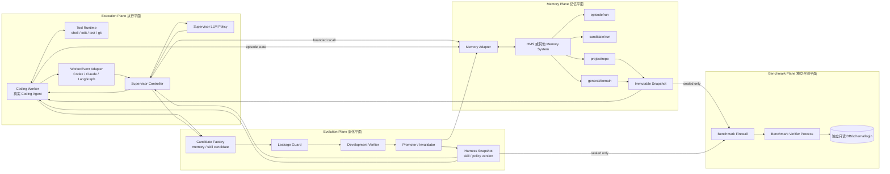
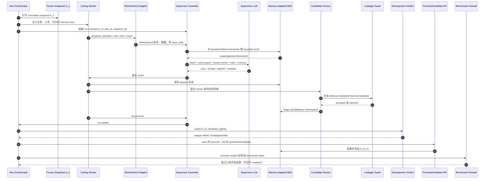
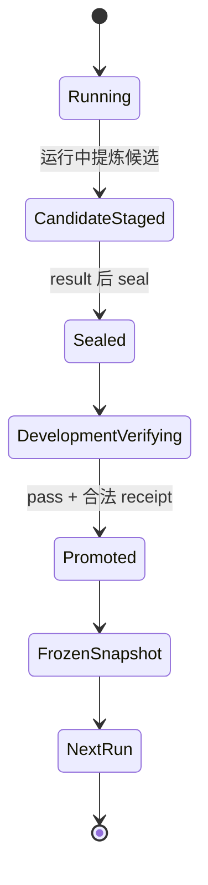
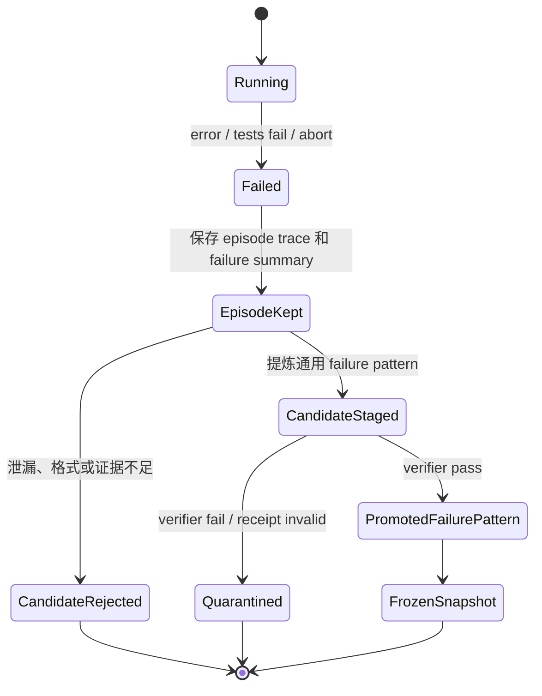
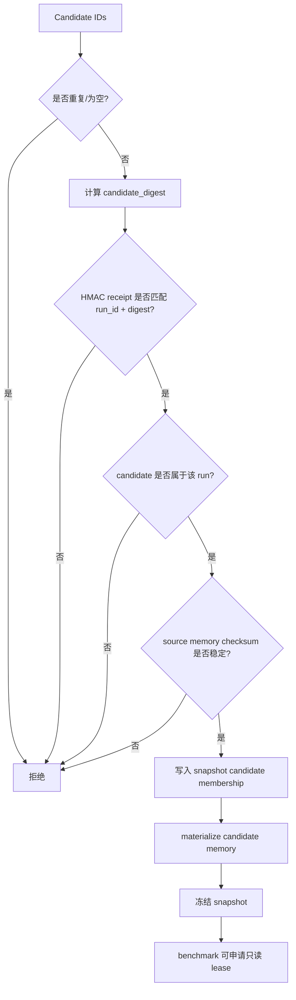
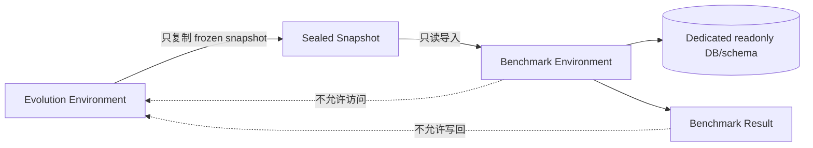
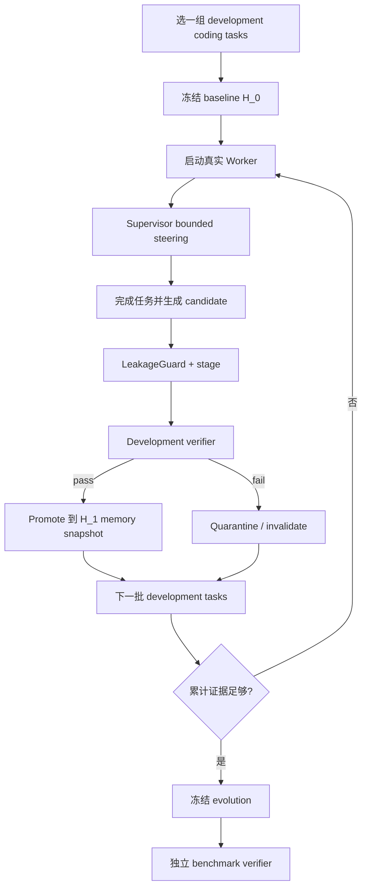
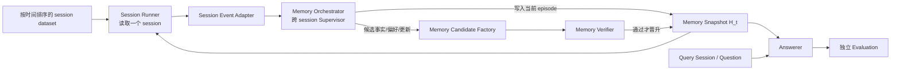
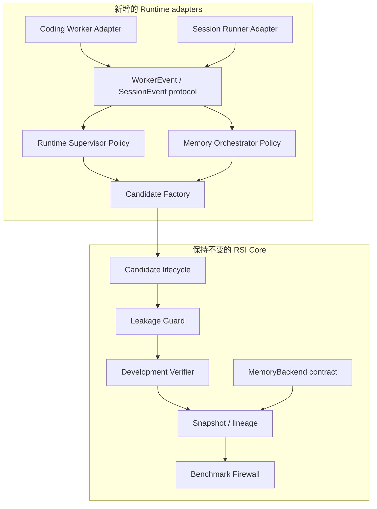

# HMS RSI Harness Pipeline 运行说明

本文说明当前 HMS Memory + RSI Harness 的完整工作方式：谁执行任务、谁监控任务、哪些信息会被传递、什么时候更新 memory、什么时候更新 skill/Harness，以及成功和失败如何保存。

这份文档也回答一个实际问题：现在是否可以开始接入 Coding Agent。

答案是：**可以开始做 development integration 和小规模运行**。HMS snapshot、candidate staging、candidate promote/invalidate、namespace tagging、完整性校验、development receipt、benchmark firewall 和 benchmark 只读 verifier 已经具备。要让它真正自动运行，还需要把真实 Coding Agent 的 Worker runtime、Supervisor LLM policy 和 Candidate Factory 接到这些 backend-neutral contract 上。当前 Codex adapter 已能产生生命周期事件，但它还不是完整的工具级 Worker monitor。

## 1. 先区分三个平面

RSI pipeline 不把所有逻辑放进 MemoryEngine，而是分成三个平面。这样 memory 后端可以替换，Worker 和 Supervisor 也可以替换。



三个平面的职责是固定的：

| 平面 | 负责什么 | 不负责什么 |
|---|---|---|
| Execution Plane | 执行任务、调用工具、产生事件、接受有限 steering | 不直接晋升长期 memory，不决定 benchmark 是否泄漏 |
| Memory Plane | recall、stage、snapshot、promote、invalidate、provenance、权限 | 不决定 Worker 下一步策略 |
| Evolution Plane | 生成候选、检查泄漏、运行 development verifier、创建新版本 | 不接收 benchmark 的明文结果 |
| Benchmark Plane | 对已经冻结的版本做独立只读评测 | 不写回 memory，不参与 candidate 生成 |

## 2. 一次任务的端到端时序

一次任务从已有 frozen snapshot 开始。Worker 只能看到当前任务允许的 snapshot 和 episode 状态；Supervisor 看到的是有限事件摘要和受限 recall。



时间顺序必须是：

```text
Worker 运行
  -> candidate 生成
  -> candidate seal
  -> development verifier
  -> promote / invalidate
  -> evolution 关闭
  -> benchmark
```

benchmark 发生在 evolution 关闭之后。benchmark 的任务、hidden test、参考答案、评分解释和逐步输出不允许回到 Candidate Factory 或 Supervisor。

## 3. Worker 监控什么

Worker 是真正执行 Coding Agent 的进程。它监控的是自己的任务执行状态，并向 Supervisor 发送结构化摘要。

### 3.1 Worker 需要观察的内容

| 信息 | 用途 |
|---|---|
| 当前目标和目标变化 | 判断是否发生 goal drift |
| 当前计划和下一步 | 让 Supervisor 知道 Worker 正准备做什么 |
| 工具调用类型 | 区分 edit、shell、test、git、search 等动作 |
| 工具调用结果摘要 | 判断动作是否成功，避免把完整输出复制给 Supervisor |
| 测试/编译/静态检查状态 | 识别可验证的进展和失败 |
| 重试次数与重复动作 | 识别循环和无效重试 |
| 当前风险 | 例如修改范围过大、依赖缺失、数据边界不清 |
| 长时间无事件 | 触发 inactivity |
| trace reference | 需要深入诊断时定位原始日志或 diff |

Worker runtime 不应该把每个 shell 输出、完整 transcript 或所有文件内容实时发送给 Supervisor。事件只发送有界摘要；原始内容保存在受访问控制的 trace store 中。

### 3.2 WorkerEvent 合同

当前统一事件格式为：

```json
{
  "run_id": "run-2026-0001",
  "worker_id": "codex-worker-1",
  "seq": 42,
  "type": "progress",
  "goal_delta": "已完成配置加载路径定位",
  "observation": "配置由 env resolver 和 yaml 默认值共同决定",
  "attempt": "读取 config_resolver.py 并运行单元测试",
  "outcome": "单元测试通过，发现一个边界分支",
  "risk": "尚未验证生产 schema 下的默认值",
  "next_step": "补充 schema 级测试并运行相关测试集",
  "trace_refs": ["trace://run-2026-0001/step-42"],
  "metadata": {"tool": "pytest"}
}
```

事件类型和含义：

```text
progress    有可验证进展
question    Worker 需要额外上下文或决策
risk        发现潜在偏离、边界或安全问题
error       当前动作失败
inactivity  超过阈值没有有效进展
result      任务结束，包含最终状态摘要
```

当前 `CodexEventAdapter` 会把 Codex hook payload 转换成该协议；`rsi_event.py` 默认只把脱敏后的结构化事件写入本地 outbox。要监控每次工具调用，需要将 Coding Agent runtime 的 tool lifecycle 接入同一个 adapter。

## 4. Supervisor 监控什么

Supervisor 不是第二个 Coding Worker。它不负责亲自修复代码，而是负责判断 Worker 是否仍在有效推进。

它维护的最小运行状态是：

```text
run context
current goal
recent event digests
open risks
retrieved memory IDs
candidate IDs
worker state
```

Supervisor 重点监控：

- Worker 是否持续产生可验证进展；
- 是否重复执行已经失败的方案；
- 是否从当前目标漂移到无关问题；
- 是否进入 inactivity；
- 是否出现风险但没有相应的下一步；
- 当前错误是否可以通过 project/general memory 中的 procedure 或 failure pattern 解决；
- 是否需要停止当前 Worker 或重新启动一个受限 Worker。

当前 `SupervisorController` 的行为是：

1. 校验 `run_id` 和单调递增的 `seq`；
2. 保存有限数量的 recent events 和 open risks；
3. 只有在 `question/risk/error/inactivity` 事件上检索记忆；
4. 把事件、目标、风险和 bounded memory 交给 `SupervisorPolicy`；
5. 校验 action 没有跨 run 或跨 worker；
6. 将 action 发送给 Worker；
7. 收到 `result` 或 `ABORT` 后结束当前 run。

Supervisor 只能返回四类 action：

```text
NOTIFY_ACK   当前策略可以继续
STEER        给出下一步受限指导
ABORT        停止当前 run
SPAWN        启动一个职责边界明确的新 Worker
```

如果底层 Agent 不支持实时注入，`STEER` 应该转换为 checkpoint 后重启 Worker，而不是假装已经实时改变了上下文。

## 5. Worker、Supervisor 和 Candidate Factory prompt

下面是推荐的 system prompt。实际部署时可以把仓库、工具和 memory adapter 的具体描述作为变量注入，但不能改变安全边界。

### 5.1 Worker prompt

```text
You are the Coding Worker.

Your job is to complete the assigned software task using the repository,
approved tools, tests, and the read-only memory snapshot provided for this run.

Operating rules:

1. Work only on the current task and repository.
2. Treat retrieved memory as advice. Verify it against the current repository.
3. Do not read benchmark hidden tests, reference patches, evaluator output,
   answer keys, or external task solutions.
4. Do not write directly to project or general long-term memory.
5. Keep temporary task state in the current episode namespace.
6. Before a major action, state a short plan and its expected evidence.
7. After each meaningful checkpoint, emit a structured WorkerEvent with:
   goal_delta, observation, attempt, outcome, risk, next_step, and trace_refs.
8. If an approach fails twice or produces contradictory evidence, emit an error
   or risk event before trying a materially different approach.
9. If blocked, ask one concrete question or wait for Supervisor steering.
10. Validate changes with the narrowest useful test first, then broaden tests.
11. At the end, emit one result event with pass/fail, validation evidence,
    remaining risks, and the next recommended action.
12. Never include benchmark material, verifier output, or hidden-answer content
    in an event, memory candidate, or trace summary.

Supervisor actions are ACK, STEER, ABORT, and SPAWN. Apply them only to this
run and worker.
```

### 5.2 Supervisor prompt

```text
You are the Runtime Supervisor for one Coding Worker run.

You do not perform the coding task yourself. You receive bounded WorkerEvent
summaries, recent event history, open risks, the current goal, and bounded
project/general memory.

Goals:

1. Keep the Worker aligned with the current task.
2. Detect repeated failure, inactivity, circular reasoning, and goal drift.
3. Suggest the smallest useful reversible intervention.
4. Prefer evidence-producing actions over speculative changes.
5. Use retrieved memory as hypotheses, not unquestionable facts.
6. Never expose benchmark information or verifier output.
7. Never mutate long-term memory or promote candidates.
8. Never invent facts absent from the event, trace, or retrieved memory.
9. Use trace_refs only when a bounded diagnostic read is necessary.
10. Abort only when the run is unsafe, irrecoverably inconsistent, or useless.

Decision rules:

- notify_ack: the Worker is making measurable progress;
- steer: the Worker is blocked, repeating a failed approach, or drifting;
- abort: continuing would be unsafe or has no reasonable recovery path;
- spawn: a new Worker with a clearly bounded role is justified.

Return exactly one JSON object:
{
  "action": "notify_ack | steer | abort | spawn",
  "instruction": "...",
  "reason": "...",
  "confidence": 0.0
}
```

### 5.3 Candidate Factory prompt

Candidate Factory 不应直接把 transcript 变成 memory。它必须从运行证据中提炼出可复用、可验证、与当前任务实例解耦的候选。

```text
You are the Candidate Factory.

Input:
- task class and repository scope;
- bounded WorkerEvent summaries;
- selected trace references;
- tests and validation summaries available before verifier execution;
- existing project/general memory used during the run.

Produce zero or more candidates. Each candidate must:

1. describe a reusable procedure, failure pattern, constraint, fact, or route;
2. state a concrete trigger and preconditions;
3. include anti-patterns and evidence_refs;
4. be useful without the exact task path, variable names, hidden tests, or
   reference patch;
5. be created before the development verifier runs;
6. contain no benchmark score, hidden-test result, verifier stdout/stderr,
   evaluator explanation, or post-verifier information.

Classify each candidate as episode, project, or general. If the information is
specific to one task instance, use episode and do not propose promotion. If
evidence is insufficient, output no candidate.
```

## 6. Memory 什么时候更新

### 6.1 Episode memory：运行中可以更新

Episode memory 是当前 run 的临时状态，允许保存当前目标和计划、工具动作摘要、错误和风险、checkpoint、trace reference 以及当前任务的局部事实。

它的命名空间是：

```text
episode/<run_id>
```

它不能被 benchmark snapshot 读取，也不能因为一次任务成功就自动升级为长期 memory。Codex 当前的 `Stop` hook 会将会话内容交给 HMS Retain，并默认写入 `rsi_namespace=episode`；这是连续性记忆，不等于 RSI promotion。

### 6.2 Candidate memory：任务结束前生成，验证后决定命运

Candidate 必须在 development verifier 运行之前生成，并包含：

```text
candidate_id
source_run_id
kind
namespace
trigger
content
preconditions
anti_patterns
evidence_refs
source_commit
created_before_verifier=true
```

Candidate 先进入 `candidate/<run_id>`。这一步只是 stage，不代表它可信，也不代表它会进入下一轮 snapshot。

### 6.3 Project/general memory：只有 promote 后更新

只有 candidate 通过 development verifier，并由合法、一次性、与 `run_id + candidate_digest` 绑定的 receipt 授权后，才进入新的 frozen snapshot。

```text
project/<repo_id>
general/<domain>
```

当前任务的临时路径、变量、局部补丁留在 episode；hidden test、参考答案、benchmark 评分和 verifier 解释拒绝进入任何长期 memory。

### 6.4 Skill/Harness library：独立版本化

Skill 库保存的不只是文字经验，还可以包含 Supervisor prompt 模板、recall 查询和排序策略、Worker checkpoint 频率、工具路由、失败重试规则、candidate 晋升阈值以及 Worker/Supervisor 组合配置。

```text
H_n
  -> HarnessCandidate
  -> leakage / schema / static checks
  -> development shadow validation
  -> verifier receipt
  -> H_(n+1)
```

Harness candidate 不能通过普通 memory retain 直接覆盖当前配置；当前实现要求 Harness promotion 具有 receipt attestation。

## 7. 成功和失败如何保留

### 7.1 成功路径



成功并不意味着“完整 transcript 变成 skill”。正确路径是：保留 episode trace；从证据提炼最小可复用候选；通过 LeakageGuard；stage；seal candidate IDs 和 digest；development verifier 返回 opaque receipt；服务端验证 receipt；promote 到新 snapshot；下一轮从新 snapshot 检索。

### 7.2 失败路径



失败可以作为当前任务的 episode failure 保留；如果能抽象成跨任务可复用的失败模式，则生成 `kind=failure` candidate，再走和成功 procedure 相同的验证流程。不能因为一次失败就自动写入永久 memory，也不能把具体 benchmark 错误或 hidden test 结果提炼成 failure pattern。

已晋升但后来不可靠的 candidate 可以被 `invalidate`。历史 frozen snapshot 保持不可变；失效只影响后续 snapshot 和检索策略。

## 8. Candidate promotion 的服务端边界



snapshot manifest 至少包含源数量、覆盖数量、source checksum 和 `memory_complete`。Benchmark Firewall 要求：

```text
snapshot.status == frozen
snapshot.manifest["memory_complete"] == true
evolution_sealed == true
```

任何条件不满足，benchmark evaluation 都必须拒绝启动。

## 9. Benchmark 为什么不会回流到进化环路



benchmark verifier 必须使用每次 evaluation 独立的 database 或 schema、独立 readonly login 和 `default_transaction_read_only=on`。同一个只读 role 如果能看到同一数据库中其他 bank 的 frozen snapshot，仍然不是严格的任务隔离。

| verifier | 能看到什么 | 输出什么 | 是否写回 evolution |
|---|---|---|---|
| Development verifier | 开发任务代码、测试和候选 seal | opaque pass/fail receipt | 是，只有合法 receipt 才能 promote |
| Benchmark verifier | frozen snapshot 和 benchmark fixture | 独立 benchmark result | 否 |

## 10. 当前代码映射

| 能力 | 当前实现 |
|---|---|
| WorkerEvent 合同 | `core/rsi-harness/rsi_harness/events.py` |
| Supervisor Controller | `core/rsi-harness/rsi_harness/runtime.py` |
| Codex event adapter | `core/rsi-harness/rsi_harness/codex_adapter.py` |
| Codex hook outbox | `interface/adapters/codex/scripts/rsi_event.py` |
| Memory backend contract | `core/rsi-harness/rsi_harness/backend.py` |
| HMS memory adapter | `core/rsi-harness/rsi_harness/hms_adapter.py` |
| candidate lifecycle | `core/rsi-harness/rsi_harness/evolution.py` |
| Harness/skill lifecycle | `core/rsi-harness/rsi_harness/harness_evolution.py` |
| leakage checks | `core/rsi-harness/rsi_harness/leakage.py` 和 HMS `rsi_store.py` |
| development verifier | `core/rsi-harness/rsi_harness/development_verifier.py` |
| benchmark firewall | `core/rsi-harness/rsi_harness/benchmark.py` |
| benchmark verifier | `core/rsi-harness/rsi_harness/benchmark_verifier.py` |
| HMS snapshot/candidate API | `core/dataplane/hms_api/engine/rsi_store.py` 和 `api/http.py` |
| HMS migration | `core/dataplane/hms_api/alembic/versions/j5k6l7m8n9o0_add_rsi_harness_state.py` |
| benchmark DB role/RLS | `deploy/rsi/benchmark_readonly_role.sql` |

## 11. 当前已经完成和还需要接入的部分

### 已完成

- backend-neutral RSI contracts；
- WorkerEvent 顺序、run boundary 和 settled boundary；
- Supervisor Controller 的 bounded recall 和 action boundary；
- HMS snapshot 的 building/frozen 生命周期；
- project/general namespace tagging；
- `memory_complete`、source checksum 和 snapshot fetch/search 校验；
- candidate staging、seal、HMAC receipt、promote、invalidate；
- promoted candidate materialization；
- benchmark firewall 和只读 snapshot view；
- benchmark verifier 的独立进程和只读 PostgreSQL transaction；
- Codex lifecycle hook 到 WorkerEvent 的 adapter；
- Harness candidate 的版本化与 receipt attestation；
- 当前核心和 adapter 测试、ruff、compileall、diff check。

### 接入真实 Coding Agent 前仍需要完成

1. 实现 `WorkerRuntime.apply()`，把 `STEER/ABORT/SPAWN` 传给真实 Agent runtime；
2. 实现一个真实的 `SupervisorPolicy.decide()`，调用部署中的 Supervisor LLM；
3. 将 shell/test/edit/tool lifecycle 接到 WorkerEvent adapter，而不仅是 SessionStart/UserPromptSubmit/Stop；
4. 实现 Candidate Factory，把 Worker trace 和验证前证据转换为 `MemoryCandidate` 或 `HarnessCandidate`；
5. 选择 development task split 和 shadow validation 规则；
6. 执行 HMS migration，配置 `HMS_API_RSI_VERIFIER_SECRET`；
7. 为 benchmark evaluation 创建独立 database/schema/login，并按 `deploy/rsi/README.md` 配置只读权限。

这些接入点不会改变 RSI 核心状态机；它们是把真实 Agent runtime 接入已经存在的合同。

## 12. 推荐的第一条可运行路径

建议先只跑 memory candidate，不立即让 Harness prompt 自修改：



第一阶段只让通用 procedure、通用 failure pattern 和明确的 project constraint 进入 candidate。等 memory candidate 的多轮收益、回滚和失效机制稳定后，再开放 Harness candidate，例如 Supervisor prompt、检索策略和工具路由策略。

## 13. 启动前检查清单

```text
[ ] baseline snapshot 已创建并 freeze
[ ] 所有可进入 snapshot 的 memory 已显式标记 project/general
[ ] snapshot.manifest.memory_complete == true
[ ] HMS RSI migration 已执行，Alembic 只有一个 head
[ ] HMS_API_RSI_VERIFIER_SECRET 已配置且 development verifier 使用同一 secret
[ ] WorkerEvent adapter 能保证每个 worker 的 seq 单调递增
[ ] Supervisor policy 不接收 benchmark 数据
[ ] Candidate Factory 在 verifier 之前运行
[ ] LeakageGuard 检查 candidate content、metadata、evidence_refs
[ ] candidate promote 使用 candidate_id，不使用 operation_id
[ ] benchmark evolution 已 sealed
[ ] benchmark URL 指向独立 database/schema/login
[ ] benchmark role 没有 live memory、candidate staging 和 verifier receipt 的 SELECT 权限
[ ] benchmark 结果没有任何回写 evolution 的路径
```

## 14. 如何判断真的发生了自进化

不能只看某一次任务成功。至少要按 run 和 snapshot 记录：

```text
task_id / task_family
base_snapshot_id
result_snapshot_id
candidate_ids
candidate_digest
development_verifier_pass
promoted_or_invalidated
worker intervention count
重复失败次数
测试通过情况
token / latency / tool-call cost
```

在不接触 benchmark 的 development split 上比较 `H_0 vs H_1 vs H_2 ...`。只有当后续 snapshot 在未参与候选生成的 held-out development tasks 上持续改善，并且没有增加泄漏、回归或成本异常，才可以称为有效 RSI。benchmark 只用于最终独立评估，不用于构造候选。

## 15. 非 Coding Agent 轨迹：适配 LongMemEval 类多 session 长数据集

可以适配。LongMemEval 本身关注长期记忆中的信息抽取、多 session 推理、时间推理、知识更新和 abstention 等能力，而不是 Coding Agent 的 shell/edit/test 轨迹。[LongMemEval ICLR 2025 页面](https://proceedings.iclr.cc/paper_files/paper/2025/hash/d813d324dbf0598bbdc9c8e79740ed01-Abstract-Conference.html)

因此不能把“一个 Worker = 一个 Coding Agent 进程”写死在 Harness 里。应将 Worker 抽象为 `SessionRunner`，将 Supervisor 抽象为 `Memory Orchestrator`：



### 15.1 这时 Worker 监控什么

Session Runner 不需要监控 shell、编译器和 git，而需要记录长期记忆系统真正关心的事件：

```text
session_start
user_message
assistant_message
fact_observed
preference_observed
entity_linked
contradiction_detected
knowledge_update_detected
session_end
query_received
answer_emitted
```

一个 session event 可以是：

```json
{
  "run_id": "lme-dev-user-017",
  "worker_id": "session-runner",
  "session_id": "session-042",
  "seq": 18,
  "type": "knowledge_update_detected",
  "observation": "用户将居住城市从 A 更新为 B",
  "attempt": "比较当前声明与已有 project memory",
  "outcome": "发现同一实体存在新旧值",
  "risk": "旧值仍可能被普通关键词检索召回",
  "next_step": "写入带有效时间和 supersedes 引用的 candidate",
  "trace_refs": ["trace://lme-dev-user-017/session-042/18"]
}
```

### 15.2 Supervisor 的职责会改变

在多 session 数据集上，Supervisor 主要监控以下状态，而不是实时指导代码操作：

- session 是否按原始时间顺序处理；
- 是否错误使用了未来 session 的信息；
- 新事实是否覆盖旧事实，还是错误地并存；
- 不同 session 的实体是否被错误合并；
- 记忆写入是否有足够 evidence；
- 检索结果是否同时覆盖多个 session；
- 当前问题是否应该回答“不知道”；
- 当前 memory snapshot 是否已经超过 token、条目或版本预算。

Supervisor action 可以扩展为：

```text
ACK_SESSION       当前 session 处理正确，继续
WRITE_CANDIDATE   允许提交一个待验证记忆候选
REVISE_UPDATE     要求重新处理冲突或时间更新
ABSTAIN            暂停写入，证据不足
ROLLBACK_VIEW     回到上一个 memory snapshot
```

这些 action 仍然可以映射到现有的 `NOTIFY_ACK/STEER/ABORT/SPAWN` 合同；新增的语义放到 action metadata 中，Memory Adapter 不需要改变。

### 15.3 多 session 下的 memory 生命周期

对于一个用户或实体，应按时间顺序执行：

```text
session_001
  -> episode_001
  -> candidate_001
  -> verifier
  -> H_001

session_002
  -> 读取 H_001
  -> 发现新事实或冲突
  -> candidate_002
  -> verifier
  -> H_002

query_session
  -> 只读取 query 时刻之前的 H_t
  -> 生成 answer
```

`H_t` 不应该是超长上下文本身，而是一个有版本的 memory view。每次 session 只向当前 view 增量写入少量候选，检索时再通过 entity、时间和 evidence refs 组合答案。这使记忆容量可以远大于模型上下文窗口。

推荐给多 session memory 的 candidate 类型：

| candidate kind | 内容 |
|---|---|
| `fact` | 可验证的用户或世界事实 |
| `preference` | 稳定偏好及其适用范围 |
| `temporal_update` | 新值覆盖旧值、有效时间和 supersedes 关系 |
| `entity_link` | 不同 session 中的同一实体关联 |
| `contradiction` | 需要保留多版本或等待更多证据的冲突 |
| `abstention_rule` | 证据不足时不应给出确定回答的规则 |
| `retrieval_policy` | 跨 session 检索、时间排序或多跳组合策略 |

### 15.4 LongMemEval 与 benchmark 泄漏的特殊边界

LongMemEval 类评测有一个容易混淆的点：历史 sessions 通常就是题目输入的一部分，因此系统在评测时需要读取和整理这些 sessions；但 gold answer、评分、人工解释以及测试问题之后产生的信息不能进入 evolution。

推荐把一次评测拆成两层：

```text
Evaluation Input Layer
  原始历史 sessions（允许按题目规定顺序 ingest）
        ↓
Evaluation-local Memory Layer
  本次 evaluation 专属、可丢弃的 memory snapshot
        ↓
Question Layer
  读取 question 之前形成的 snapshot，产生答案
        ↓
Scoring Layer
  在独立进程中读取答案并评分，不回写 memory/evolution
```

这意味着当前 benchmark verifier 的只读数据库设计需要区分两种模式：

1. **预构建 snapshot 模式**：在 benchmark verifier 启动前，将允许的历史 sessions 预先 materialize 到专属 frozen snapshot；verifier 全程只读。这与当前 `BenchmarkFirewall` 和只读 role 直接兼容。
2. **评测侧 ingest 模式**：benchmark 进程先把历史 sessions 写入一个本次 evaluation 独立的临时数据库，然后冻结，再以只读连接回答问题。这个临时数据库不能与 evolution database 共享写权限，也不能向 HMS candidate store 回写。

对标准 test split，不能使用 test question 的答案、gold evidence、评分结果或后处理错误来生成下一轮 candidate。真正要研究“多 session 运行后是否变好”，应当使用独立 development split 做演化，使用 held-out test split 做最终评估，并且每个 test evaluation 使用干净的 evaluation-local memory。

### 15.5 多 session 的 prompt 变化

Session Runner 的 prompt 可以替换 Coding Worker prompt：

```text
You are a Session Memory Runner.

Process sessions strictly in the supplied chronological order. At each
session, distinguish observations from inferred facts. Do not use any future
session or question answer. When a new statement conflicts with an old memory,
record the conflict and its time instead of silently overwriting it.

For every session checkpoint, emit a bounded event containing:
session_id, sequence, observed evidence, candidate change, temporal scope,
entity references, contradiction risk, and next action.

Only submit a memory candidate when it has evidence in the sessions already
processed. Do not include benchmark answers, labels, scores, or evaluator
feedback in a candidate.
```

Memory Orchestrator 的 prompt 可以是：

```text
You are the Memory Orchestrator for a chronological multi-session run.

Maintain a bounded view of the current memory snapshot. Check temporal order,
entity identity, evidence coverage, stale-value invalidation, and abstention.
When evidence is insufficient, choose ABSTAIN. When a value changes, require
an explicit supersedes relation and validity interval. Never use future sessions
or benchmark scoring information. Return one action and a short reason.
```

### 15.6 适配后的成功判据

在多 session 场景，不能只测最终 answer accuracy。至少应记录：

```text
memory write precision
memory write recall
stale-value suppression
temporal update accuracy
entity-link accuracy
cross-session evidence coverage
abstention precision
answer accuracy
retrieval latency / token cost
```

如果 `H_0 -> H_1 -> H_2` 在新的 development user/session streams 上持续提高这些指标，同时 test split 完全隔离、每次 evaluation 的 memory 干净重建，才可以说是长期记忆系统上的 RSI，而不是把某个 benchmark 的答案缓存下来。

## 16. 架构是否需要调整

结论是：**不需要重写当前架构，但需要增加 session-oriented 的一层适配和一个独立的 Memory Orchestrator。** 当前的 `MemoryBackend`、snapshot、candidate、verifier、promote/invalidate 和 benchmark firewall 仍然可以复用。



### 16.1 不需要调整的部分

以下组件的抽象已经适用于 Coding Agent 和多 session memory：

- `MemoryBackend` 的 search、stage、promote、snapshot、invalidate contract；
- `EvolutionSession` 的 stage → seal → verify → promote 状态机；
- `HarnessEvolutionSession` 的 skill/policy snapshot；
- LeakageGuard 和 `created_before_verifier` 时间边界；
- HMS 的 `building -> frozen` snapshot；
- `memory_complete` 和 source checksum；
- benchmark 只读 view、独立 verifier 和 benchmark embargo；
- candidate 与 snapshot 的 provenance、digest 和 receipt 机制。

因此不需要为 LongMemEval 单独复制一套 memory system，也不需要把所有 session 历史塞进模型上下文。

### 16.2 必须新增的部分

#### A. Session Runner Adapter

现有 `WorkerRuntime` 面向“有工具调用的主动 Agent”。多 session 数据集需要一个并列的 adapter：

```python
class SessionRunner(Protocol):
    async def ingest(self, session: SessionInput, view: FrozenMemoryView) -> None: ...
    async def answer(self, query: QueryInput, view: FrozenMemoryView) -> Answer: ...
```

它负责按原始顺序读取 session、生成 session event，并在 query 时刻只读取允许的 snapshot。原有 Coding Agent 继续使用 `CodingWorkerAdapter`，两者共享 `WorkerEvent` 的核心字段，但 session runner 需要额外的 `session_id`、`event_time` 和 `source_position`。

#### B. Runtime Supervisor 与 Memory Orchestrator 分离

现有 `SupervisorController` 适合处理实时 steering：是否继续、改变下一步、停止 Worker。多 session memory 还需要判断：是否写入事实、是否 supersede 旧值、是否保留冲突、是否 abstain。

这两类决策应该保持两个 policy：

```text
Runtime Supervisor
  负责 Worker/session runner 当前怎么运行

Memory Orchestrator
  负责 memory candidate 如何形成、更新、冲突和失效
```

它们可以共享事件总线和 bounded retrieval，但不能让 Runtime Supervisor 直接修改长期 memory。Memory Orchestrator 的输出仍然先进入 Candidate Factory 和 verifier，不能直接写入 `project/general`。

#### C. Candidate Factory 作为一等组件

当前核心 contract 已支持 candidate，但具体的 Candidate Factory 仍需要接入。它应当消费：

```text
已处理 session 的 event summaries
允许的 trace refs
当前 snapshot 中的相关 memory
时间和实体信息
```

它输出 `MemoryCandidate` 或 `HarnessCandidate`。它不能消费 benchmark gold answer、评分或 verifier 解释，也不能在 verifier 返回之后修改原 candidate。

#### D. Snapshot manifest 增加 session watermark

对多 session 数据，单纯的 `memory_source_checksum` 还不够。建议在 snapshot manifest 增加：

```json
{
  "stream_id": "user-017",
  "last_session_id": "session-042",
  "last_source_position": 42,
  "max_event_time": "2026-09-06T10:20:00Z",
  "source_dataset_version": "development-v1",
  "memory_complete": true
}
```

这样可以验证 query 是否读取了未来 session，并支持从某个 session watermark 恢复。

#### E. 时间和更新关系成为显式 provenance

LongMemEval 类数据不应只保存一段文本。对于事实更新，至少要表达：

```text
valid_from
valid_to
observed_at
supersedes_memory_id
entity_id
source_session_id
```

第一版可以放在 candidate metadata 和 memory metadata 中；如果要把 temporal reasoning 做成正式能力，最终应在 memory backend 中提供 typed fields 和查询约束，避免所有逻辑依赖自由文本。

### 16.3 Benchmark ingest 需要单独的入口

当前 `BenchmarkVerifierProcess` 默认使用只读数据库连接，这是安全的，但它假设评测所需的 snapshot 已经提前 materialize。LongMemEval 有两种运行方式：

```text
方式一：Evaluation Snapshot Builder
历史 sessions -> 独立 builder -> frozen evaluation snapshot
                                  -> read-only benchmark verifier

方式二：Evaluation-local Ingestor
历史 sessions -> 本次评测独立临时 DB -> freeze -> read-only query phase
```

不能让 benchmark verifier 使用 evolution 数据库的普通写权限。推荐先实现方式一，因为它与现有 Benchmark Firewall、`memory_complete` 和只读 role 直接兼容。

### 16.4 当前代码层面的最小调整顺序

如果下一步确定以 LongMemEval 类数据为主要实验对象，建议按以下顺序实现：

1. 增加 `SessionInput`、`QueryInput` 和 `SessionEvent` 数据合同；
2. 增加 `SessionRunnerAdapter`，先支持离线 chronological replay；
3. 在 `RunContext` 或 snapshot manifest 中加入 `stream_id` 和 session watermark；
4. 实现 `MemoryOrchestratorPolicy`，把写入、更新、冲突和 abstention 与 runtime steering 分开；
5. 实现 Candidate Factory；
6. 为 `temporal_update`、`entity_link` 和 `contradiction` 增加 candidate metadata/验证规则；
7. 实现 development stream verifier；
8. 最后接 LongMemEval 的 evaluation snapshot builder 和只读 benchmark verifier。

这是一组增量扩展，不需要改变现有 HMS candidate promote API，也不需要把 Coding Agent 的逻辑复制一份。

### 16.5 什么情况下才需要改数据库 schema

如果只是先验证 pipeline，session ID、时间和 supersedes 关系可以放在 `metadata`、`evidence_refs` 和 `source_commit` 中，当前 schema 可以启动实验。

如果要长期支持多 session temporal reasoning、冲突分析和高质量审计，建议新增 typed provenance columns 或单独的 memory relation table。此时应保持原始 memory text 不变，通过关系表表达：

```text
memory_id -> entity_id
memory_id -> source_session_id
memory_id -> supersedes_memory_id
memory_id -> valid_time interval
```

这样可以避免用一次新的文本写入覆盖历史事实，也能让 snapshot completeness 同时验证 memory content 和关系 provenance。

### 16.6 最终判断

当前架构可以直接开始做 LongMemEval 类实验，前提是先把 Coding-specific 的入口替换为 session adapter。需要调整的是运行时角色和 session provenance，不是 RSI 核心状态机。

推荐的最终结构是：

```text
Session Runner / Coding Worker
          ↓
      Event Adapter
          ↓
  Runtime Supervisor       Memory Orchestrator
          ↓                         ↓
       steering              Candidate Factory
                                    ↓
                  Leakage → Verifier → Snapshot
                                             ↓
                                  next session / benchmark
```

## 17. LongMemEval 方向的实现 TODO 顺序

下面的顺序按依赖关系排列。前一阶段没有通过验收时，不进入后一阶段。这样可以避免先做 benchmark 接入，最后才发现 session 顺序、future leakage 或 memory update 语义没有定义清楚。

### Phase 0：冻结实验边界和数据切分

先写一份不可变的实验配置，不改代码也可以开始：

```text
development split：允许生成 candidate 和更新 H_n
held-out development split：只用于 shadow validation
benchmark/test split：只读评测，不允许回写 evolution
evaluation_id：每次评测唯一
stream_id：用户/实体/对话流唯一
session order：严格按 source_position 和 event_time
```

需要确定：

- 是使用预构建 evaluation snapshot，还是 evaluation-local ingest；
- 每个 user stream 是否独立 memory；
- candidate 是每个 session 晋升，还是每 N 个 session 批量晋升；
- 失败和冲突是否保留为独立 candidate；
- 第一阶段只演化 memory，还是同时演化 retrieval policy。

验收条件：可以给定一个 evaluation ID，明确列出哪些输入能进入 evolution、哪些输入只能进入评测。

### Phase 1：增加通用 session 数据合同

新建建议模块：

```text
core/rsi-harness/rsi_harness/session_models.py
core/rsi-harness/rsi_harness/session_events.py
```

至少定义：

```python
SessionInput(
    stream_id,
    session_id,
    source_position,
    started_at,
    ended_at,
    messages,
    metadata,
)

QueryInput(
    evaluation_id,
    stream_id,
    query_id,
    query,
    query_position,
)

SessionEvent(
    run_id,
    stream_id,
    session_id,
    sequence,
    event_type,
    event_time,
    source_position,
    observation,
    evidence_refs,
)
```

同时调整：

- `RunContext` 增加可选的 `stream_id`；
- `WorkerEvent` 或其公共基类增加 `session_id`、`event_time`、`source_position`；
- 事件校验从“每个 worker seq 单调”扩展为“每个 stream/session 的 source position 不得倒退”；
- 所有 evidence ref 都必须绑定 stream、session 和 position。

验收条件：可以解析一组多 session 输入，并拒绝乱序、重复、跨 stream 和 future session 事件。

### Phase 2：实现离线 Session Runner

新建：

```text
core/rsi-harness/rsi_harness/session_runner.py
```

第一版不需要 LLM。它只做确定性的 chronological replay：

1. 读取一个 stream 的 sessions；
2. 校验顺序和时间；
3. 逐条发出 `SessionEvent`；
4. 在 session boundary 生成 checkpoint；
5. 在 query boundary 停止 ingest；
6. 返回当前 snapshot 和 event trace。

验收条件：相同输入、相同初始 snapshot、相同配置必须产生相同 event sequence 和相同 ingest watermark。

### Phase 3：拆出 Memory Orchestrator

新建：

```text
core/rsi-harness/rsi_harness/memory_orchestrator.py
```

定义独立 policy：

```python
class MemoryOrchestratorPolicy(Protocol):
    async def decide(
        self,
        event: SessionEvent,
        *,
        memories: Sequence[MemoryHit],
        context: MemoryOrchestratorContext,
    ) -> MemoryDecision: ...
```

`MemoryDecision` 至少包括：

```text
NOOP
PROPOSE_CANDIDATE
SUPERSEDE
KEEP_CONFLICT
ABSTAIN
INVALIDATE
```

Runtime Supervisor 继续负责当前 Worker/session runner 怎么运行；Memory Orchestrator 只负责 memory 如何变化。两者共享 event bus，但不能互相绕过 candidate lifecycle。

验收条件：Runtime Supervisor 没有任何直接写 project/general memory 的方法；所有 memory mutation 都产生 candidate 并进入 stage。

### Phase 4：实现 Candidate Factory

新建：

```text
core/rsi-harness/rsi_harness/candidate_factory.py
```

Candidate Factory 根据 event、bounded trace 和当前 snapshot 生成：

```text
fact
preference
temporal_update
entity_link
contradiction
abstention_rule
retrieval_policy
```

第一版只支持三个最小类型：

```text
fact
temporal_update
contradiction
```

必须实现：

- candidate 在 verifier 之前生成；
- candidate 带 source session/position；
- candidate 带 `preconditions`、`evidence_refs` 和 `created_before_verifier=true`；
- candidate 不包含 gold answer、score、verifier output；
- Candidate Factory 不读取 benchmark result。

验收条件：同一事件不会产生重复 candidate；缺少证据时输出空集合；future session 内容无法被引用。

### Phase 5：增加时间更新和冲突 provenance

第一版可以先放在 candidate/memory metadata：

```json
{
  "entity_id": "entity-17",
  "source_session_id": "session-042",
  "observed_at": "2026-09-06T10:20:00Z",
  "valid_from": "2026-09-06T10:20:00Z",
  "valid_to": null,
  "supersedes_memory_id": "memory-0031"
}
```

如果 development stream 验证表明 temporal reasoning 是主要瓶颈，再新增 migration 和 relation table。不要在第一步就把所有 temporal semantics 固化到数据库，以免在 event contract 尚未稳定时反复迁移。

验收条件：旧值不会被无来源地覆盖；新值可以显式 supersede 旧值；冲突值可同时保留；query 能按 query position 过滤未来值。

### Phase 6：扩展 snapshot lineage 和 watermark

调整：

- `HarnessSnapshot.manifest`；
- HMS `rsi_harness_snapshots.manifest`；
- snapshot completeness 校验；
- snapshot search/fetch 的时间边界。

新增 manifest 字段：

```text
stream_id
last_session_id
last_source_position
max_event_time
source_dataset_version
```

父 snapshot 继承时，必须验证 child watermark 不早于 parent；query snapshot 不得覆盖 query position 之后的 memory。

验收条件：给定任意 snapshot，可以回答“它最多看到了哪个 session/position”，并能拒绝 future-memory 读取。

### Phase 7：实现 development stream verifier

当前 `DevelopmentVerifierProcess` 可以保留作为进程和 receipt 边界，但 verifier 命令需要从 coding tests 扩展为 session-stream validation：

```text
输入：development stream + candidate seal + base snapshot
输出：opaque pass/fail receipt
```

verifier 内部可以测：

- memory write precision/recall；
- temporal update accuracy；
- stale-value suppression；
- entity-link accuracy；
- abstention precision；
- answer accuracy；
- latency 和 token cost。

verifier 输出给 promotion controller 的仍然只能是 opaque receipt，不得返回 gold answer 或逐题解释。

验收条件：receipt 与 `run_id + candidate_digest` 绑定，一次消费；verifier 失败时 candidate 不进入新 snapshot。

### Phase 8：实现 Evaluation Snapshot Builder

优先实现预构建 snapshot 模式：

```text
development/evaluation input
    -> Evaluation Snapshot Builder
    -> frozen evaluation snapshot
    -> BenchmarkFirewall
    -> read-only BenchmarkVerifier
```

Builder 使用独立 evaluation ID 和 memory namespace，不能调用 evolution store 的 promote API，也不能读取其他 evaluation 的 snapshot。

验收条件：同一个 benchmark evaluation 只能读取自己的 snapshot；benchmark role 无法读取 live memory、candidate staging 和 verifier receipts；benchmark 结果没有回写路径。

### Phase 9：LongMemEval 适配和指标

增加 dataset adapter：

```text
core/rsi-harness/rsi_harness/datasets/longmem_adapter.py
```

它只负责格式转换和顺序约束，不负责修改 memory policy。运行时要记录：

```text
stream_id
session_id
source_position
query_position
snapshot_id
retrieved_memory_ids
candidate_ids
answer_id
```

指标至少分为：

```text
memory operation metrics
answer metrics
resource metrics
leakage/integrity metrics
```

验收条件：能比较 `H_0/H_1/H_2` 在未用于候选生成的 held-out development stream 上的收益，并能单独报告 benchmark test 结果。

### Phase 10：最后才开放 Harness/skill 自进化

memory candidate 稳定后，再开放：

- retrieval policy candidate；
- temporal conflict policy；
- Memory Orchestrator prompt；
- candidate threshold；
- session checkpoint frequency；
- entity resolution routing。

每次 Harness 变化必须经过：

```text
HarnessCandidate
    -> schema/static checks
    -> development shadow validation
    -> receipt attestation
    -> new Harness snapshot
```

验收条件：新 policy 在 held-out development stream 上至少不回归，并可以恢复到上一版 Harness snapshot。

### 建议的实际执行顺序

```text
现在：      Phase 0 + Phase 1
第一轮：    Phase 2 + Phase 3
第二轮：    Phase 4 + Phase 5
第三轮：    Phase 6 + Phase 7
隔离完成：  Phase 8 + Phase 9
稳定以后：  Phase 10
```

不要从 Phase 8 或 Phase 10 开始。没有 session watermark 和 Candidate Factory，benchmark 分数无法说明是 memory RSI；没有 development stream verifier，Harness prompt 自修改也没有可信的晋升依据。

### 当前实现进度

当前已经完成 Phase 1 的核心合同、Phase 2–4 的离线闭环，以及第一版
development-only 的 memory/skill promotion：

```text
已实现：
  SessionInput / QueryInput / SessionEvent
  stream_id / session_id / source_position / event_time
  ChronologicalSessionRunner
  LongMemEval-shaped adapter（不携带 answer/gold annotation）
  MemoryOrchestratorPolicy
  RuleBasedMemoryOrchestratorPolicy
  CandidateFactory
  candidate 的 deterministic ID、evidence 和 leakage 检查
  SessionEvolutionRunner
  event enricher 边界（只能补语义，不能改变 source identity/order）
  DevelopmentStreamVerifier（只返回 opaque HMAC receipt）
  InMemorySkillLibrary / SkillEvolutionController
  FileSkillLibrary / JsonSnapshotStore（重启后保持 skill current pointer）
  EvaluationSnapshotBuilder
  EvaluationLease 的 memory_snapshot_id / skill_snapshot_id
  BenchmarkVerifier 的 frozen snapshot 环境变量
  FrozenBenchmarkRunner 和 HMS PostgreSQL frozen snapshot backend

仍待接入部署侧：
  真实 session semantic extractor / LLM policy
  snapshot watermark 的 HMS typed 持久化字段
  temporal relation table
  独立 development 数据源和 held-out development split
  benchmark 只读 database/schema/login
```

当前离线验证使用 LongMemEval 的公开字段结构构造小型 fixture，验证 session 数组、日期、session ID、query position、`has_answer` annotation 去除、顺序回放和 candidate 生成。没有把 benchmark gold answer 写入 RSI candidate，也没有把 test split 用作 evolution 数据。

### 当前可运行的 development smoke

可以在不启动数据库、不调用模型供应商的情况下验证一次 `H0 -> H1`：

```bash
PYTHONPATH=core/rsi-harness \
  python core/rsi-harness/examples/longmem_rsi_smoke.py
```

这个 smoke 使用 LongMemEval 的字段合同构造独立 development fixture。原始
item 中故意包含 `answer` 和 `has_answer`，但它们只留在 fixture/verifier
边界；`LongMemEvalRuntimeItem`、`SessionInput`、`QueryInput` 和
`SessionEvolutionTrace` 都不会携带这些字段。输出应同时包含：

```text
memory_promoted: true
skill_promoted: true
runtime_contains_reference_answer: false
```

这不是 LongMemEval 分数，也不能替代真实 development verifier。它只验收
顺序回放、候选 seal、opaque receipt、memory snapshot 和 skill snapshot 的
生命周期。

若要快速验收“运行一轮后确实变好”，可运行
`core/rsi-harness/examples/longmem_h0_h1_smoke.py`。它先在 candidate 尚未
晋升时记录 H0，再用 development opaque receipt 晋升同一条事实并记录 H1；
fixture 的输出应为 `h0_passed=false`、`h1_passed=true`、`delta=1`。参考答案
只被 smoke 的最终评分函数使用，不进入 runtime、candidate 或 verifier。

线上或长时间运行的 development worker 应把 `InMemorySkillLibrary` 换成
`FileSkillLibrary`（或实现相同 `SkillLibrary` 合同的数据库适配器）。每个
cohort 先读取当前 snapshot，候选通过 opaque receipt 后才原子推进
`current.json`；失败 cohort 的 candidate/audit 保留，但不会改变下一轮使用的
skill 版本。这样 skill 更新跨越 worker 重启仍然是单调、可回滚的 snapshot
lineage。

真实 benchmark 仍按 [LongMemEval reproduction README](../lab/evaluation/benchmarks/longmemeval/README.md)
运行 baseline。只有在独立 development stream 上产生并通过 `H_n` 后，才可以
 用 `EvaluationSnapshotBuilder` 绑定 frozen memory snapshot 和 skill snapshot，
 再通过 `BenchmarkFirewall` 打开只读 lease。benchmark 过程不能反向调用
 `SkillEvolutionController`。

对于 HMS 的 PostgreSQL 部署，frozen benchmark 使用
`benchmarks.longmemeval.frozen_longmemeval`。它只查询
`rsi_harness_snapshots` 和 `rsi_snapshot_memory_units`，不会像普通 H0
runner 一样做 documents/chunks preflight，也不会创建可写 `MemoryEngine`。

### 本轮验收记录

在当前工作区已经完成并验证：

- `PYTHONPATH=core/rsi-harness pytest -q core/rsi-harness/tests interface/adapters/codex/tests`：163 passed；
- `PYTHONPATH=core/rsi-harness:lab/evaluation pytest -q core/rsi-harness/tests lab/evaluation/benchmarks/longmemeval/test_frozen_snapshot_backend.py`：74 passed；
- `ruff check`、`compileall`、`bash -n .aaaSCRIPT/run_benchmark.sh` 和 `git diff --check` 通过；
- `longmem_rsi_smoke.py` 验证 memory/skill promotion；
- `longmem_h0_h1_smoke.py` 验证 H0=false、H1=true、delta=1，且 runtime 不含 reference-answer 字段。

这里的 smoke 是无外部依赖的生命周期验收，不代表已经在真实 PostgreSQL、模型 endpoint
和完整 LongMemEval 500 项数据上得到分数。真实评测仍需要部署 migration、创建独立
benchmark readonly login、准备 development 生成的 snapshot map 和 skill snapshot，
再执行 LongMemEval README 中的 H0/H1 命令。
