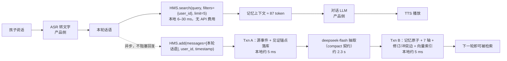

# 场景测算：情感陪伴 AI 玩具接入 HMS Elite（2026-09-11）

依据本轮真实测评（deepseek-flash + 本地 fastembed，`extraction_output=compact` 契约——可选项，库默认为 `full`（2026-09-18 起库默认为 `lines`，见 CONTRACT 变更记录第 108 行），见 CONTRACT §6.5）把一个具体产品场景的写入速度、检索速度、token 消耗和人民币费用算出来。所有实测数字的来源在文末；未实测的量标为「假设」或「估算」。计算脚本输出：`benchmarks/egolife/results/scenario_companion_toy.json`。

## 1. 场景与假设

| 项 | 取值 | 性质 |
|---|---|---|
| 产品 | 毛绒外形的情感陪伴 AI 玩具，语音交互；记忆层记住孩子说过的事、喜好、情绪、家人 | 场景设定 |
| 交互量 | 每天 3 次对话，每次 15 轮用户话语 → 每天 45 句，每月 1,350 句 | 假设 |
| 每句长度 | 20–40 个汉字；与探针所用的 15–18 词英文句同量级 | 假设（token 实测基于英文） |
| 记忆产出 | 逐句写入时每句约 1 条记忆；批量写入时每句约 1.7 条原子 | 实测（探针 / smoke） |
| 计价 | deepseek-flash，元 / 百万 token：缓存命中 0.02（高峰 0.04）、未命中 1（高峰 2）、输出 4（高峰 8）；高峰 = 北京时间周一至周五 9:00–12:00、14:00–18:00 | 官方价目（2026-09-11 抓取） |
| 使用时段 | 儿童玩具以晚间和周末为主，多数请求落在空闲价 | 假设 |

## 2. 数据流

关键路径上只有检索（本地毫秒级）；写入在旁路异步完成，玩具的回复延迟由 ASR、对话 LLM、TTS 决定，不由记忆层决定。若孩子在 2.4 s 内接着说下一句，上一句的记忆可能还没落库，这一段由对话 LLM 自己的上下文窗口覆盖。

记忆层在这个场景里做的三件事：

- **修订不删除**：「我最喜欢奥特曼」→ 一个月后「我现在最喜欢恐龙」→ 新原子通过 supersession 边替代旧原子，旧的保留为历史，检索默认只回当前有效的。
- **情绪轴**：每条原子带 sentiment，`personal_state` 卡片能给出「最近几天的情绪走向」，供对话 LLM 调整语气。
- **可回溯**：每条记忆都指向原话的见证锚点，家长端能看到「玩具为什么这么记」。

## 3. 写入：两种策略

| 指标 | A. 逐句即时写（每句一次 add） | B. 会话结束批量写（15 句一次 add） |
|---|---|---|
| 每句 token：输入（缓存命中 / 未命中）/ 输出 | 1,943（1,280 / 645）/ 456 | 281（69 / 212）/ 130 |
| 每句费用（空闲 / 高峰） | ¥0.00249 / ¥0.00499 | ¥0.00073 / ¥0.00147 |
| 延迟 | 2,355 ms 端到端（其中 LLM 2,350 ms），异步 | 每句摊 385 ms 模型 + 10 ms 本地；15 句一批约 5.9 s，会话末异步 |
| 记忆可检索的时刻 | 说完约 2.4 s 后 | 会话结束约 6 s 后 |
| 每句产出 | 约 1 条记忆 | 约 1.7 条原子 |
| 参考：full 契约 | ¥0.00306 / ¥0.00612，3,140 ms | ¥0.00237 / ¥0.00474，每句摊 595 ms |

A 的单句费用高于 B 三倍多，原因是每次请求都要重新读一遍系统提示词（缓存命中 1,280 token）并输出完整信封（456 token 里只有约 80 token 是记忆本身）。产品上可以混合：情绪强烈或明确的「记住这个」用 A，其余用 B。

## 4. 检索

| 指标 | 数值 | 来源 |
|---|---|---|
| 检索本地耗时（几百条记忆） | 6–9 ms | 探针 |
| 检索本地耗时（8,439 条原子） | 中位 11.4 ms，P95 28 ms（含查询嵌入 3.8 ms） | r3 204 题 |
| API 费用 | 0（嵌入与打分都在本地） | — |
| 注入对话 LLM 的记忆上下文 | 5 条记忆行 ≈ 87 token / 轮，若对话模型也是 deepseek-flash 约 ¥0.00009 / 轮 | r3 每行 59 字符换算 |

## 5. 账单

每用户每月（1,350 句）：

| 策略 | 费用（空闲 / 高峰） | 输入 token（其中缓存命中） | 输出 token | 新增原子 |
|---|---|---|---|---|
| A 逐句即时写 | ¥3.37 / ¥6.74 | 2.62M（1.73M） | 0.62M | ≈1,350 |
| B 会话批量写 | ¥0.99 / ¥1.98 | 0.38M（0.09M） | 0.18M | ≈2,300 |
| 参考：full 契约 A / B | ¥4.13 / ¥8.26；¥3.20 / ¥6.39 | 3.34M；0.76M | 0.83M；0.67M | — |

1 万台玩具每月：A ¥33,677（空闲）/ ¥67,354（高峰）；B ¥9,901 / ¥19,801。检索侧无 API 费用。

## 6. 存储增长（按实测折算）

r3 整库 54.6 MB / 8,439 条原子，即每条原子连同源事件、锚点、FTS 与 384 维向量约 6.5 KB（实测）。A 策略每用户每月约 9 MB，B 约 15 MB；一年 105–180 MB/用户，单机 SQLite 可承载，万级用户需按用户分库或换 Milvus 索引提供者。

## 7. 口径与来源

- 单句写入：`benchmarks/egolife/results/probe_single_message.json`（6 句英文探针，热态中位，2026-09-11）。
- 批量写入：`results/real/elite_compact_entities_smoke5_r2`（18 批 / 395 窗口 / 672 原子，deepseek-flash 实际 usage）。
- full 参考：`results/real/elite_full204_r3`（290 批 / 4,851 窗口 / 8,473 原子）。
- 检索：r3 的 `questions_elite_rows.jsonl` timing_ms.recall_local；探针 search 计时。
- 未实测：中文 token 数（按英文同量级假设）、交互频次、对话 LLM 与 ASR/TTS 的费用与延迟（产品侧，不计入）。
